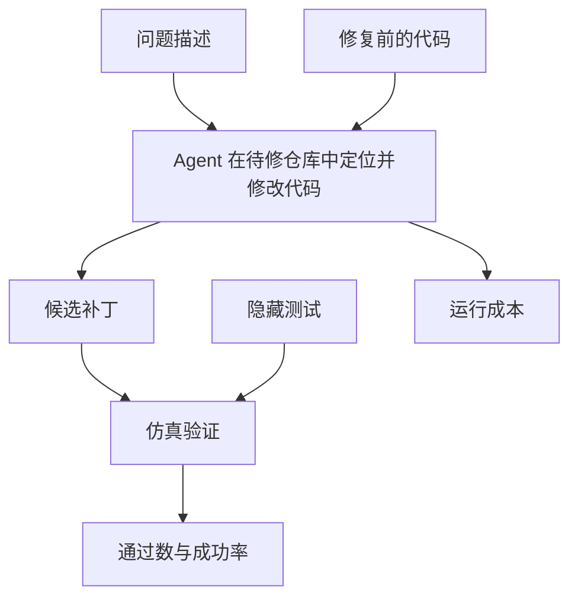
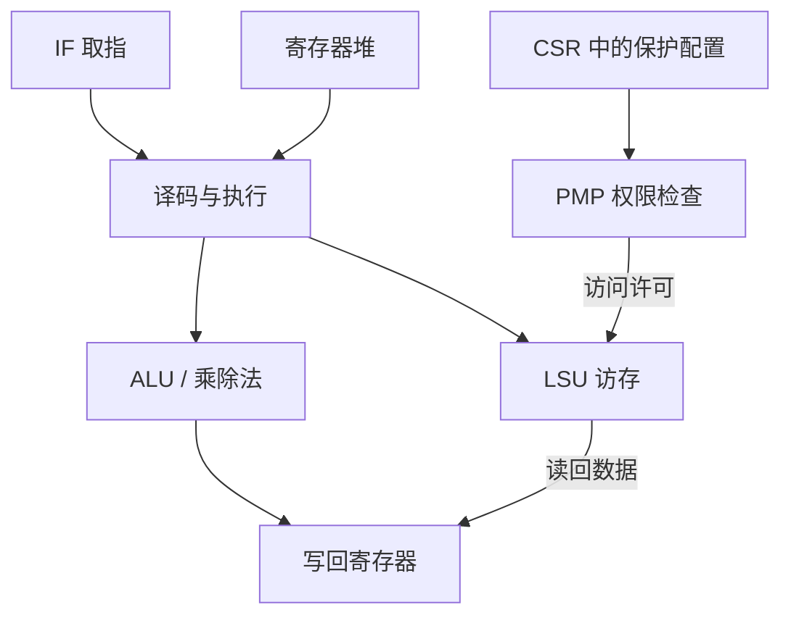
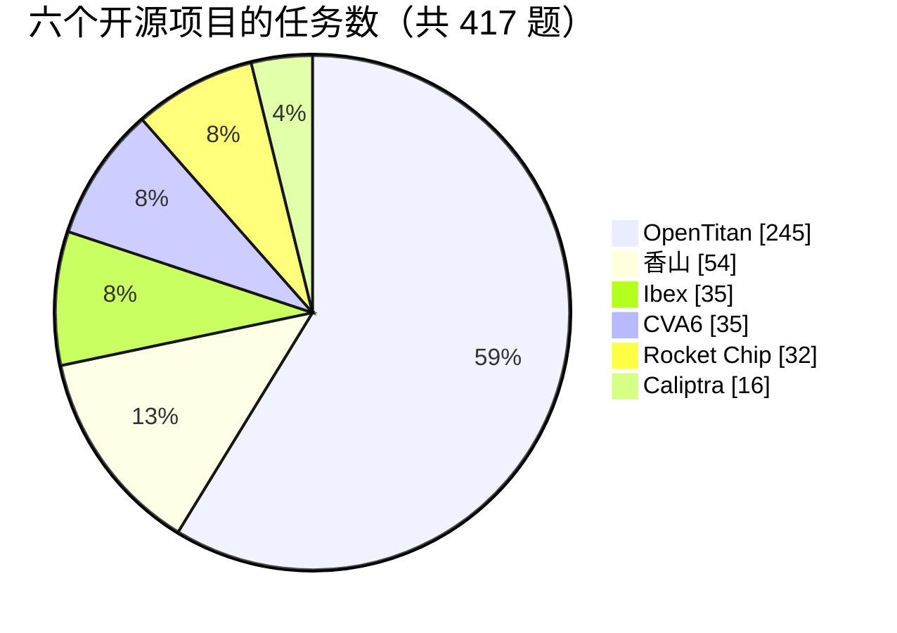
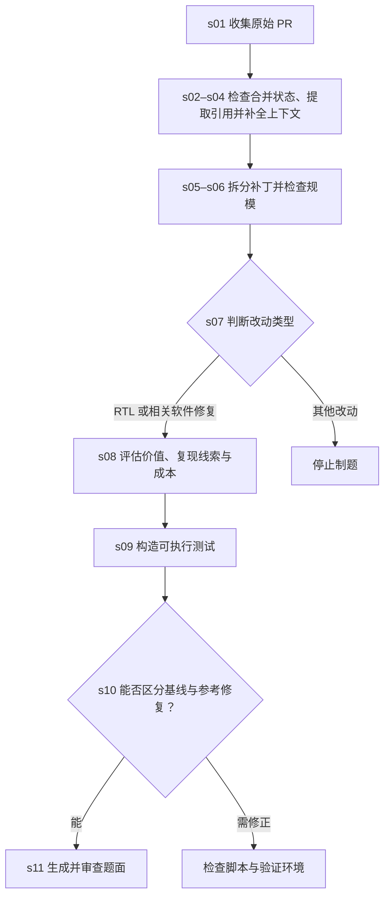
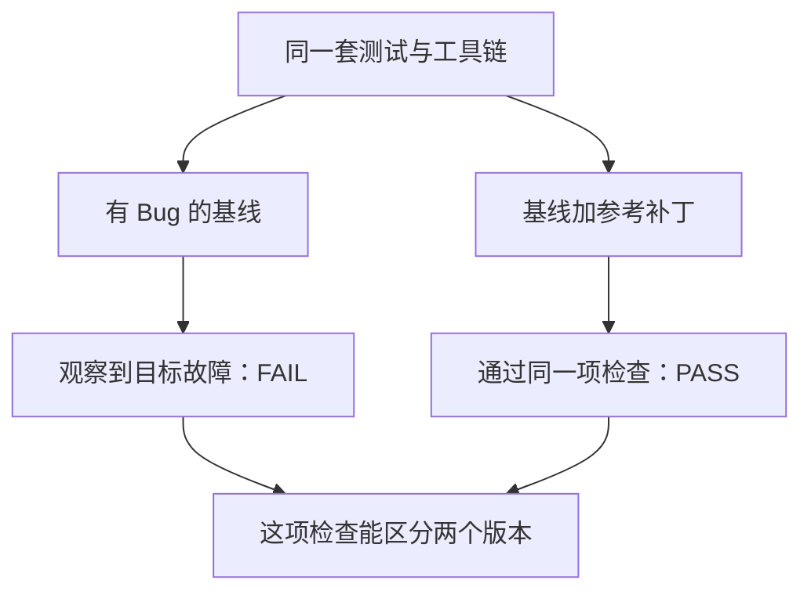
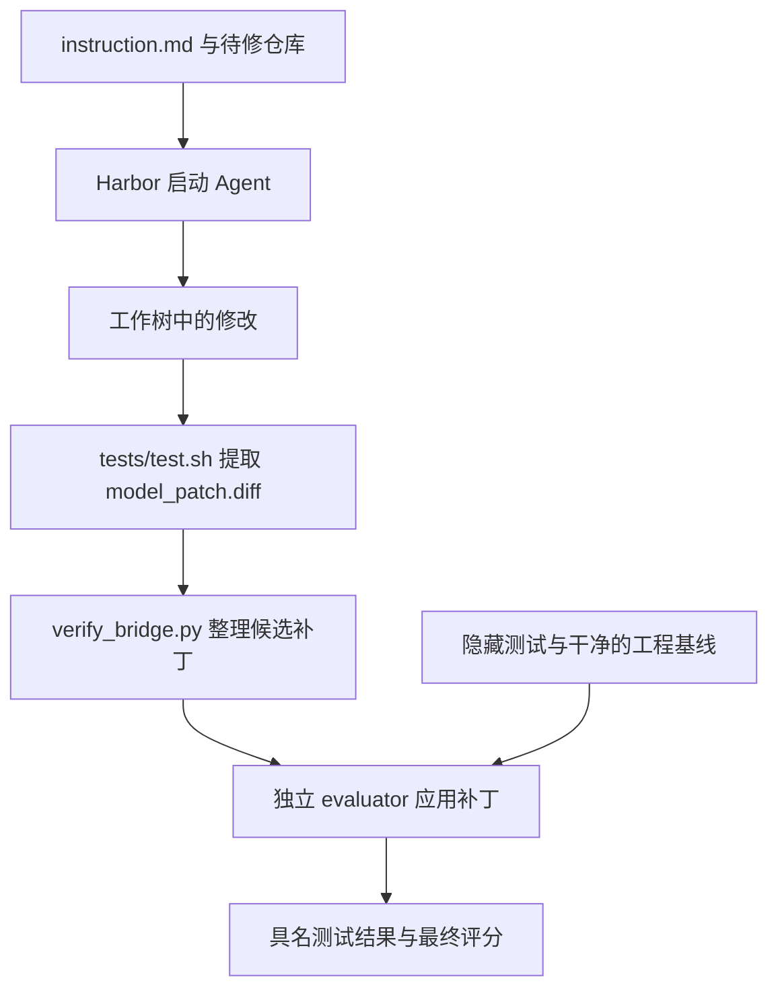
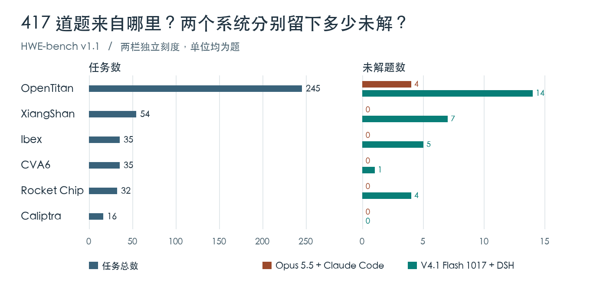

# 基于 HWE-bench v1.1 的学习、研究与诊断

**HWE-bench（Hardware Engineering Benchmark）是一个专门评估 AI Agent 修复数字芯片 RTL 代码 Bug 能力的基准测试项目。**

它想回答一个问题：**当前的大模型，究竟能不能像真正的芯片工程师一样，独立定位并修复硬件设计中的 Bug？**

### **1. 它具体做什么？**

项目从 Ibex、CVA6、香山、OpenTitan 等 6 个真实开源芯片项目中，整理了 **417 个真实 Bug 修复任务**。

对每个任务：

1. **准备问题**：提供存在 Bug 的代码版本，以及问题描述。

2. **让 Agent 工作**：例如 Claude Code、Codex，自主阅读 RTL、分析问题、修改代码。

3. **验证结果**：通过仿真测试判断 Agent 是否真正修好了 Bug。

4. **统计能力**：比较不同模型的成功率、成本等指标。

### **2. 它不仅是一个数据集**

这个项目实际上包含三个重要部分：

- **任务构建系统**：从真实 GitHub PR 中筛选 Bug，构造可复现的任务。

- **Agent 运行环境**：利用 Docker、Harbor 等工具，让模型在真实代码仓库中工作。

- **评测系统**：使用仿真测试自动判断修复是否成功。

### **3. 目前的版本**

2026 年 11 月 10 日发布了 **v1.1**，主要修改了 188 个任务的隐藏测试和 50 个任务的问题描述，并重新评测了 7 个 Agent。官方报告 Claude Opus 5.5 max 达到 413/417。

来源：[GitHub 仓库](https://github.com/pku-liang/hwe-bench?utm_source=chatgpt.com) · [官方排行榜](https://pku-liang.github.io/hwe-bench/?utm_source=chatgpt.com)

我建议我们首先弄清楚一个基本问题：

**HWE-bench 是如何把一个真实的芯片 Bug 修复 PR，转化成一个可以交给 Agent 独立完成、又能自动判断对错的任务的？**

这是理解整个项目最核心的起点，也直接关系到后续能否将它发展为强化学习训练环境。

---

> 现在简单介绍一下，他选择的这六个开源项目 都详细介绍一下他的芯片架构 然后各个模块的功能从最简单的芯片开始然后逐渐就是复杂的项目

HWE-bench 选择的六个项目，其实覆盖了三类硬件：**CPU 处理器核、安全处理器，以及完整的 SoC（片上系统）**。

我按大致的架构理解难度，从简单到复杂介绍。注意，这不是严格的芯片性能排名。

## **1. Ibex：最基础的处理器**

32 位 RISC-V　2～3 级流水线　HWE-bench：35 题

**定位：** 小型、低功耗 CPU 核，可以用于微控制器、安全芯片等。

它的工作流程很简单：

取指令 → 译码 → 执行 → 写回结果。

主要模块：

- **IF（取指单元）**：根据程序计数器 PC，从存储器读取下一条指令。

- **Decoder（译码器）**：识别指令，例如加法、跳转、读取内存。

- **Register File（寄存器堆）**：存储 CPU 当前运算使用的数据。

- **ALU（算术逻辑单元）**：完成加减法、位运算和比较。

- **Multiplier/Divider**：执行乘除法。

- **LSU（访存单元）**：执行 Load、Store，读写数据存储器。

- **CSR（控制状态寄存器）**：管理中断、异常及处理器状态。

- **PMP（物理内存保护）**：检查访问的物理地址是否被允许。

Ibex 采用顺序执行，主要优势是结构简单、面积小、容易集成。

## **2. CVA6：能运行复杂操作系统的 CPU**

32/64 位 RISC-V　6 级流水线　35 题

**定位：** 面向应用级计算的 CPU 核，支持虚拟内存，适用于 Linux 等操作系统环境。

相比 Ibex，它的处理器结构更完整。

主要增加或强化了这些模块：

- **Frontend（前端）**：负责 PC 生成、分支预测和取指。

- **Decode（译码）**：将指令转换为内部控制信息。

- **Issue（发射）**：检查数据依赖，决定指令何时可以进入执行单元。

- **Scoreboard（记分牌）**：记录在途指令和运算结果，处理数据相关与完成顺序。

- **Execute（执行单元）**：包含 ALU、乘除法单元，以及可配置的浮点计算单元 FPU。

- **Commit（提交）**：按照程序顺序确认指令结果，维护精确异常。

- **MMU（内存管理单元）**：把虚拟地址转换成物理地址，支持操作系统的虚拟内存管理。

- **I-Cache / D-Cache**：分别缓存指令和数据，减少访存等待。

CVA6 仍是**顺序发射的处理器**，但不同指令的执行结果可以在不同时间返回，再统一按顺序提交。

## **3. Caliptra：专门负责安全的处理器**

RISC-V + 密码学硬件　安全子系统　16 题

**定位：** 可以集成到大型 SoC 中的硬件信任根（Root of Trust，RoT）。

它不是为了高速运行普通程序，而是为了确保设备启动、固件和密钥可信。

核心模块：

- **VeeR EL2 CPU**：32 位 RISC-V 处理器，运行安全固件。

- **ROM / ICCM / DCCM**：分别提供启动代码、指令存储和数据存储。

- **SHA 加速器**：计算哈希，验证数据完整性。

- **ECC 加速器**：执行椭圆曲线公钥密码运算，用于签名验证等操作。

- **HMAC**：基于密钥和哈希算法完成消息认证。

- **Key Vault（密钥保险库）**：安全保存密钥，限制直接读取密钥材料。

- **PCR Vault**：保存固件、启动状态等测量结果。

- **Mailbox**：与外部主 SoC 交换安全命令及数据。

- **Lockstep（锁步）机制**：通过冗余执行及结果比较检测部分硬件故障。

例如设备启动时，Caliptra 可以验证固件签名，记录启动测量结果，再向主系统提供可信状态。

## **4. Rocket Chip：从 CPU 扩展到完整计算系统**

RISC-V　多核 SoC 生成器　32 题

**定位：** 一个能够配置、生成不同 RISC-V SoC 的硬件设计框架，而不只是某颗固定芯片。

注意，**Rocket Core 和 Rocket Chip 不一样**。Rocket Core 是五级流水线、顺序执行的 CPU；Rocket Chip 则能将多个 CPU 核、缓存、总线、外设组合成系统。

主要模块：

- **Rocket Core**：执行 RISC-V 程序的 CPU 核。

- **RocketTile**：将 CPU、一级指令缓存、数据缓存、页表遍历器等封装在一起。

- **L2 Cache**：可配置的共享二级缓存，减少访问外部内存的次数。

- **TileLink**：连接 CPU、缓存、外设的片上互连协议，也支持缓存一致性。

- **SystemBus / MemoryBus**：负责不同模块间的数据传输。

- **PLIC / CLINT**：处理中断及处理器间的控制事件。

- **RoCC 接口**：允许接入自定义硬件加速器。

- **Diplomacy**：自动协调不同硬件模块之间的接口和参数。

Rocket Chip 最值得关注的是**多模块集成、总线协议、缓存一致性与参数化硬件生成**。代码使用 Chisel 编写。

## **5. OpenTitan：完整的安全 SoC**

安全微控制器　完整 SoC　245 题

**定位：** 完整的开源安全芯片工程，涵盖 CPU、存储器、密码运算、通信接口、电源管理和安全控制。

以 Earl Grey 架构为例，它包含：

**计算系统**：Ibex CPU、中断控制器、调试模块。

**存储系统**：ROM、SRAM、非易失存储器以及相应控制器，保存启动程序、运行数据、固件和安全配置。

**密码学系统**：AES、HMAC、KMAC、OTBN（大整数运算加速器）、随机数发生器等。

**安全控制系统**：Key Manager（密钥管理）、Life Cycle Controller（生命周期状态管理）、Alert Handler（安全告警处理）、OTP Controller（一次性可编程数据管理）。

**通信接口**：UART、SPI、I²C、USB、GPIO 等。

**系统管理**：时钟控制、复位、电源状态和看门狗。

这些模块通过片上总线连接，形成一套完整的安全计算系统。

它和 Caliptra 的区别在于：Caliptra 更强调可嵌入其他 SoC 的安全模块；OpenTitan 则有完整的安全微控制器设计及更广泛的外围系统。

值得注意，**HWE-bench 的 417 道题中有 245 道来自 OpenTitan**，占比约 59%。研究该基准时，这个项目非常重要。

## **6. 香山（XiangShan）：高性能乱序 CPU**

64 位 RISC-V　超标量乱序执行　54 题

**定位：** 面向高性能计算的 RISC-V CPU 微架构。

它与 Ibex、Rocket 的最大区别是采用了复杂的\*\*乱序执行（Out-of-Order Execution）\*\*机制。

以香山的南湖架构为例：

**前端：**

- Branch Predictor：预测分支跳转，避免流水线频繁等待。

- Instruction Fetch：从 I-Cache 取得指令。

- Decoder：译码并识别指令类型。

**乱序控制系统：**

- Rename（寄存器重命名）：解决不同指令使用相同架构寄存器名造成的虚假依赖。

- Dispatch（分派）：将指令送到相应执行队列。

- Reservation Station（保留站）：保存等待执行的指令，等操作数准备好再发射。

- ROB（重排序缓冲区）：记录尚未提交的指令，保证最终按程序顺序更新架构状态。

**执行系统：**

- Integer Block：整数运算、乘除法、跳转。

- Float Block：浮点运算。

- Memory Block：Load/Store 队列、访存顺序控制。

- Cache / TLB：多级缓存和地址转换。

南湖架构支持六发射，允许多条指令并行执行，也允许后面的指令在条件满足时先于前面的指令执行。

因此，香山的难点集中在**指令相关性、乱序调度、推测执行、流水线恢复、缓存和访存一致性**等方面。不同代际的香山架构会有差异。

## **放在一起理解**

这六个项目分别代表了不同层次的硬件工程问题：

| 项目        | 核心研究对象 | 主要难点               |
|-------------|--------------|------------------------|
| Ibex        | 简单 CPU     | 流水线、指令执行       |
| CVA6        | 应用级 CPU   | 数据相关、MMU、缓存    |
| Caliptra    | 安全子系统   | 密码学、密钥、安全状态 |
| Rocket Chip | SoC 生成框架 | 多核、总线、缓存一致性 |
| OpenTitan   | 安全 SoC     | 多 IP 集成、系统级安全 |
| 香山        | 高性能 CPU   | 乱序执行、复杂流水线   |

**对于 HWE-bench，我们接下来尤其需要区分两个概念：项目本身的复杂程度，不等于其中 Bug 修复任务的难度。**

例如 OpenTitan 虽然是一个完整的 SoC，但其中某个任务可能只是修复 UART 寄存器行为；Ibex 虽然很小，一个涉及流水线异常处理的 Bug 却可能相当难。

下一步，我认为可以具体看看 **HWE-bench 在这六个项目中究竟选择了什么样的 Bug，以及这些 Bug 分布在哪些硬件模块中**。这比单纯研究芯片架构更有助于我们理解这个 Benchmark 的实际难度。

---

> 对，我们看一下他选择了什么样的bug 就是首先是他选择之前主要的那些PR都是有哪些我们要讲具体一点就是要带例子的，我们分类之后需要带例子的 它主要是哪些一些问题，然后然后再看他用了什么选择方法，具体的你要去看代码，就是他是或者是要么是用简单代码筛选或者是用Agent 说我们要知道他是具体怎么去用什么样的方法去筛选，然后用什么样那个流程筛选，最后筛选出来的问题是都有哪些？

我查了 HWE-bench 的论文、GitHub 源码，包括 `s02、s05、s06、s07、s08` 的实际实现，以及 Hugging Face 上公开的部分 v1.1 任务数据。

有一个非常值得注意的事实：

**HWE-bench 并不是直接收集 RTL Bug，而是先收集真实工程 PR，再通过规则、LLM 分类、可复现性评估和仿真验证，逐步将其转化为 Benchmark。**

论文称，最初从六个项目中收集了 **超过 30,000 个 PR，最终留下 417 个任务**。

我们从你关心的三个问题来拆：

1.  真实工程里有哪些 Bug？具体 PR 修复了什么？

2.  项目通过什么代码和 Agent 筛选这些 PR？

3.  最后的 417 道题是什么结构，有什么倾向和缺陷？

## **一、首先看看它把 Bug 分成了哪些类别**

源码中的 `s7_instruction.py` 定义了两级分类体系。第一级有三种结果：`RTL_BUG_FIX`、`SW_BUG_FIX` 和 `OTHER`，前两种可以保留，第三种排除。

### **1. RTL 设计 Bug**

| 分类               | 具体问题                                                    |
|--------------------|-------------------------------------------------------------|
| `RTL_LOGIC`        | 功能逻辑错误：FSM 状态跳转错误、判断条件错误、位宽错误等    |
| `RTL_SPEC`         | 规范实现错误：例如 RISC-V 指令或特权规范没有正确实现        |
| `RTL_INTERFACE`    | 接口协议错误：AXI、TileLink、valid-ready 握手或事务顺序错误 |
| `RTL_TIMING_SYNC`  | 时钟、复位、CDC、竞争条件等同步问题                         |
| `RTL_CONFIG_INTEG` | 参数配置、模块例化、顶层连线、系统集成错误                  |
| `RTL_OTHER`        | 其他真正影响硬件行为的 RTL Bug                              |

### **2. 软件与硬件交互 Bug**

| 分类             | 具体问题                                     |
|------------------|----------------------------------------------|
| `SW_HW_CONFIG`   | 固件错误配置寄存器、初始化顺序或使能位       |
| `SW_HW_INTERACT` | 软件错误处理中断、DMA、硬件状态、握手等      |
| `SW_FW_LOGIC`    | 固件或相关软件自身的算法、判断和边界处理错误 |
| `SW_OTHER`       | 其他软件 Bug                                 |

此外，纯测试代码错误、文档修改、代码重构、新功能、CI/CD 和构建系统修改等，原则上会被归入 `OTHER`。

这不是我自己设计的分类，而是项目给分类 Agent 使用的明确规则。[查看原始分类 Prompt](https://github.com/pku-liang/hwe-bench/blob/main/hwe_bench/collect/s7_instruction.py?utm_source=chatgpt.com)

## **二、真实的 PR 到底修复了什么？看六个入选例子**

下面这些不是虚构案例，而是我从 v1.1 数据集里找到、并对照了原始 PR 或补丁的实例。

分类名称是为了方便理解而归纳的；除特别注明外，不代表我已经逐条核对了数据集中保存的 `level2` 标签。

### **例子 1：Ibex \#2232——CPU 调试模式下，PMP 错误拦截内存访问**

偏 RTL_SPEC：处理器规范实现错误

[查看原始 PR](https://github.com/lowRISC/ibex/pull/2232)

**问题：** RISC-V 规定，CPU 进入 Debug Mode 后，不能因为 PMP（物理内存保护）的普通访问限制，而拒绝访问 Debug Module 所在的地址范围。

原来的 Ibex 实现却可能拒绝这种访问。

**怎么修：** 给 `ibex_pmp.sv` 增加调试模式输入，以及 Debug Module 的地址范围参数，并调整权限判断，使调试模式下的这类访问得到放行。

这个任务真正考察的不是写一个条件判断，而是理解：**CPU 调试状态如何影响 PMP 的权限语义。**

值得注意的是，原始 PR 明确表示没有同时提供验证，HWE-bench 后来需要为它准备可执行的测试。

### **例子 2：Rocket Chip \#404——I-Cache 复位后错误地产生有效响应**

偏 RTL_LOGIC：复位初值错误

[查看原始 PR](https://github.com/chipsalliance/rocket-chip/pull/404)

这是一个只有一行修改的真实 Bug。

某些寄存器随机初值会让指令缓存 `I-Cache` 在刚退出复位后，就声称自己有有效数据。

原补丁修改了 Chisel 代码：

<pre><code>- val s2_hit = RegEnable(s1_hit, !stall)
+ val s2_hit = RegEnable(s1_hit, Bool(false), !stall)</code></pre>

区别是给 `s2_hit` 明确增加初始值 `false`。

这里考察的是：**有效位在复位之后是否具有确定状态**。代码只改了一行，但如果不了解缓存流水线，就未必能判断错误来源。

### **例子 3：香山 \#3307——分支预测前端的 FTQ 提交条件错误**

偏 RTL_LOGIC：复杂流水线状态控制错误

[查看原始 PR](https://github.com/OpenXiangShan/XiangShan/pull/3307)

FTQ（Fetch Target Queue，取指目标队列）记录前端取指及预测相关信息。

原来的提交条件没有正确处理部分指令被冲刷（Flush）、部分指令正常提交的情况，可能导致队列指针推进和分支预测器更新不正确。

**怎么修：** 重新判断 FTQ 条目中最后一条有效指令是否已提交，并将队列条目提交条件与提交指针移动条件分开处理。

原始补丁只涉及 `NewFtq.scala` 一个文件，却需要同时理解前端、ROB（重排序缓冲区）、Flush 和 Load Replay。

这就比简单的组合逻辑错误复杂得多。

### **例子 4：Caliptra \#963——密钥读取错误状态没有被正确保留**

偏 RTL_LOGIC / RTL_INTERFACE：安全状态与接口行为错误

[查看原始 PR](https://github.com/chipsalliance/caliptra-rtl/pull/963)

这个 PR 实际上修复了不止一个问题。

首先，在 KeyVault 访问过程中，之前发生的错误可能被传输最后一个数据拍的状态覆盖，导致最终错误信息丢失。

其次，AES 读取新密钥时，中间的密钥暂存寄存器没有按要求清零，可能残留旧密钥材料。

**怎么修：** 锁存并保留访问期间出现的错误状态，同时在读取新密钥时对中间寄存器进行清零。

这个例子包含安全设计中非常典型的要求：**错误不能被后续成功状态抹掉，敏感数据不能在寄存器里无意残留。**

### **例子 5：OpenTitan \#10732——掉电复位信号没有正确传到部分内部模块**

偏 RTL_TIMING_SYNC / RTL_CONFIG_INTEG：复位网络错误

[查看原始 PR](https://github.com/lowRISC/opentitan/pull/10732)

问题出现在 `rstmgr`（Reset Manager，复位管理器）。

原来的复位连接关系不完整。在外部 `por_n_i` 复位信号拉低、但某些时钟已经停止的情况下，部分内部复位节点不能可靠地被复位。

**怎么修：** 调整复位树，让内部 Power-on Reset 直接作为有关复位节点的上级复位源。

它考察的是跨模块的时钟、复位传播和系统集成，而不只是某个寄存器的复位值。这个 PR 也是官方 v1.1 测试修订说明中涉及的案例之一。

### **例子 6：CVA6 \#1482——SPIKE 模拟器对扩展指令的解码条件错误**

数据集标签：SW_BUG_FIX / SW_FW_LOGIC

[查看原始 PR](https://github.com/openhwfoundation/cva6/pull/1482)

这是一个容易忽视的例子：**它修复的不是 RTL，而是相关的软件指令解码逻辑。**

在 SPIKE 的 CV-X-IF 相关解码中，`funct7` 字段的掩码有误。

原来使用：

funct7 & 0xe

修改为：

funct7 & 0x7e

这改变了参与匹配的指令编码位，避免把某些不应匹配的扩展指令错误地识别为支持的操作。

因此，HWE-bench 的真实任务并不全是 Verilog/SystemVerilog/Chisel 的 RTL 修改，也包含部分与硬件项目直接相关的软件修复。

从这些实例可以看出，最终数据集覆盖了**简单的复位初值、CPU 规范、复杂流水线控制、安全状态、跨模块复位，以及软硬件协同问题**。

## **三、源码里究竟怎么筛选？11 个步骤**

我把实际代码按“做了什么、用什么做、怎样淘汰”整理如下。

| 步骤               | 方法                  | 具体行为                                      |
|--------------------|-----------------------|-----------------------------------------------|
| s01 收集 PR        | GitHub API            | 获取六个仓库的 PR、描述、Commit 等            |
| s02 关联 Issue     | DeepSeek / 正则       | 只保留已合并且找到 Issue 引用的 PR            |
| s03–s04 获取 Issue | GitHub API + Python   | 拉取 Issue 标题、正文，与 PR 合并             |
| s05 提取补丁       | Python `unidiff`      | 获取 Diff，拆成 `fix_patch` 和 `test_patch`   |
| s06 限制规模       | Python 规则           | 删除修改文件过多、代码变更过大的 PR           |
| s07 分类           | Codex Agent           | 判断 RTL Bug、软件 Bug、其他                  |
| s08 评估可行性     | Codex Agent           | 评价任务价值、复现线索、仿真成本              |
| s09 生成测试       | Codex + 仿真          | 为候选任务制作能复现 Bug 的测试               |
| s10 验证测试       | Docker + 仿真 + Codex | 确认原代码失败、修复后通过                    |
| s11 生成题目       | Codex Agent           | 编写给被测 Agent 看的问题描述，并检查信息泄漏 |

这是源码中的实际结构，而不是单纯的论文概念图。

### **重点看几个真正决定结果的步骤**

**s02：不是判断 Bug，只是寻找 Issue 关联。**

它先判断：

if pull.get("state") != "closed":
        return None
    if not pull.get("merged_at"):
        return None

然后默认调用 `deepseek-reasoner`，从 PR 标题、正文、Commit Message 中提取 Issue 编号。也可以通过 `--no-llm` 改为正则匹配。

这里发现一个值得注意的细节：Prompt 实际要求提取所有被引用的 Issue，连 `related to #123` 这样的引用也算，**并没有严格证明这个 PR 修复的就是那个 Issue**。

例如 Caliptra \#963 关联的 \#977 主要涉及 AES 缺少头文件，但这个 PR 的重要内容还包括 KeyVault 错误锁存和密钥清零。这说明 PR 与 Issue 的关系可能并不完全一致。

[查看 s02 源码](https://github.com/pku-liang/hwe-bench/blob/7bab86a/hwe_bench/collect/s2_filter_by_issues.py)

**s05–s06：简单代码规则筛选。**

s05 通过文件路径区分修复代码和测试代码：文件路径包含 `test`、`tb`、`testbench` 等字符串的 Diff，被分入 `test_patch`；其他通常进入 `fix_patch`。没有 `fix_patch` 的 PR 会被排除。

s06 的默认规则是：

max_files_changed = 50
    max_rows_changed = 2000

也就是说，修改超过 50 个文件，或者增加与删除的行数合计超过 2000 行，就会被排除。

这是非常直接的启发式规则，不涉及 Agent。

**s07：真正判断 Bug 类型的 Agent。**

当前代码默认使用 `gpt-5.4`，通过 Codex CLI 传入 PR 的描述、Issue 和代码补丁，再要求输出结构化 JSON：

{
      "level1": "RTL_BUG_FIX",
      "level2": "RTL_LOGIC",
      "confidence": 0.95,
      "reasoning": "..."
    }

其中 `OTHER` 不进入下一轮评分。

需要区分：`gpt-5.4` 是目前源码中的默认配置，不能据此推断历史上全部 417 个任务都由这个版本分类。

查看 s07 执行代码

**s08：判断这个 Bug 适不适合制作 Benchmark。**

这个 Agent 不直接决定最终保留，而是给出四个维度的 0～2 分：

| 指标                | 问的是什么                   |
|---------------------|------------------------------|
| `benchmark_value`   | 是否具有真实工程调试价值？   |
| `cross_layer_depth` | 软件 Bug 需要多少硬件知识？  |
| `reproducer_signal` | 有没有足够线索制作复现测试？ |
| `simulation_cost`   | 仿真成本有多高？             |

随后由代码计算：

Priority=4BV+2CLD+6RS−3SC

举个实际例子，CVA6 \#1482 在数据中的四个评分分别为 `1、1、1、0`，得到优先级分数 12。

但要注意：**这个分数不是最终录取线。**

在 s09 的 `prepare_input.py` 中，可以通过 `--min-bv 1 --min-rs 1` 等参数设置筛选条件，但这些阈值是可配置的，不能说项目无条件按某个固定分数截断。

[查看 s08 Prompt](https://github.com/pku-liang/hwe-bench/blob/7bab86a/hwe_bench/collect/s8_instruction.py) · [查看 s09 输入筛选代码](https://github.com/pku-liang/hwe-bench/tree/7bab86a/hwe_bench/harness/tbgen/prepare_input.py)

### **s09–s11：真正把 PR 变成一道题**

这里是最关键的一步。

例如 Rocket Chip \#404 已经确认有 Bug，也知道官方怎么修，但这还不能直接成为 Benchmark。

必须建立测试：

原始有 Bug 的版本

FAIL

测试必须检测到错误，例如复位后出现不应有的有效 I-Cache 响应。

------------------------------------------------------------------------

应用原始 PR 修复补丁后

PASS

同一个测试应当通过，证明修复消除了可观测错误。

s09 让 Codex 生成 `tb_script.sh` 等测试脚本；s10 在 Docker 中进行标准化验证，必要时修复测试脚本；s11 再生成不直接透露补丁和隐藏测试的问题描述。

## **四、最终筛出来的 417 个问题**

官方 v1.1 数据集的项目分布如下：

来源：HWE-bench v1.1 官方发布说明

从已核对的实例和论文分类来看，最后保留下来的问题主要包括功能逻辑、架构规范、接口协议、参数集成、复位时序，以及少量软硬件相关软件问题。

但我目前还没有完整统计 417 个 JSONL 条目的全部 `level2` 字段，所以不能给出每种 Bug 的准确数量，也不能给出 s01 到 s11 每个阶段的真实淘汰数。

## **五、我发现的三个值得进一步研究的问题**

**第一，筛选过程存在明显的样本选择偏差。** 一个真正困难的芯片 Bug，如果没有关联 Issue、改动超过大小限制，或者很难构造仿真测试，就可能被排除。因此，417 个任务代表的是“能被这套流程制作成可验证任务的问题”，而不是六个工程中所有具有代表性的 Bug。

**第二，真实的修复 PR 与 Benchmark 任务不是一一等价的。** 例如 Rocket Chip [\#485](https://github.com/chipsalliance/rocket-chip/pull/485) 也在最终数据中，原 PR 的核心是引入新的 AHB Adapter，包含相当多新增代码。它究竟属于修复既有缺陷还是实现新功能，值得专门审查，不能仅凭入选就认定分类完全正确。

**第三，Fail-to-Pass 只能证明特定测试能区分两个版本，不能保证测试充分理解 Bug。** 这不是纯理论担忧：官方 v1.1 就因为测试不充分、过度依赖参考补丁实现方式等问题，修改了 188 个任务的隐藏测试及 50 个问题描述。

我认为我们已经抓到这个项目的核心逻辑：

**它不是纯粹在筛选 Bug 的技术难度，而是在筛选有工程价值、能够自动复现并可靠评分的 Bug。**

这两个目标并不完全一致。

下一步值得做的是选一个真实样本（我倾向 Ibex \#2232 或香山 \#3307），完整追踪它的 **原始 Issue → PR Diff → 分类评分 → 生成的测试脚本 → 最终 Agent 题目**。这样我们能进一步判断，这套流程究竟保留了原始问题的多少工程难度。

---

> 原始 Issue → PR Diff 还是先关注这一流程我建议你去直接看一下原始的issue 他们到底都涉及到哪些问题比如说我们可以简单分类啊，比如说可能涉及到协议理解错误，或者说指令级的具体的理解中错误，还有一些比如说模块间的一些问题对吧还有一些具体的功能实现笔误之类的，我不知道有哪些呀，这是我假设的一些类别，所以我需要你去看真实的那几千个issue里面他们都是哪一些更新？针对的是在从就从芯片制成来看，他们针对的是哪些角度哪些方面就是根本原因是哪一些的，这种就是从复杂度的这种角度来去看它的最终的一个解决的问题的位置

我觉得这次需要换一个研究角度：**不再按 RTL、接口、时序这些代码类型分类，而是研究芯片工程师究竟在哪一层认知或设计决策上出了问题。**

例如，同样修改一个 `if` 条件，根因可能完全不同：

- 把 `>` 写成 `>=`：局部实现错误。

- 没正确理解 RISC-V 特权规范：指令或架构语义理解错误。

- 没考虑 FIFO 在 Flush 时的状态：时序行为理解不完整。

- 没考虑两个模块之间的约束：系统级设计错误。

虽然最终修改都可能只有一行，**但它们所需的知识、定位能力和修复难度完全不同**。

先说明研究范围：论文记录了六个仓库合计超过 30,000 个原始 **PR**，并不是说有 30,000 个已确认的 Bug Issue。最终公开的是 417 个经过验证的任务。要对全部原始问题给出准确比例，还需要重建原始 PR–Issue 集合并逐条分析；下面先基于已核实的历史 Issue 与对应 PR 建立分类。

## **一、按根因所在的设计层次分类**

我建议先建立这样一套分类框架，按照理解范围大致从小到大排列。

| 层次 | 根因发生在什么地方 | 典型问题                           |
|------|--------------------|------------------------------------|
| L1   | 代码表达           | 笔误、常量、位宽、掩码、初值       |
| L2   | 单模块功能         | FSM、计数器、FIFO、运算逻辑        |
| L3   | 时间与状态演化     | 握手、流水线、Flush、Replay、复位  |
| L4   | 架构及协议语义     | RISC-V 指令、CSR、AXI、TileLink    |
| L5   | 模块之间的协作     | 中断、跨模块控制、总线与缓存       |
| L6   | 芯片系统约束       | 时钟、复位树、电源域、安全生命周期 |
| L7   | 工程配置与实现     | 参数化、寄存器配置、固件、构建流程 |

这里的 L1–L7 是**根因理解范围的分层，不是线性的难度评分**。某个单模块算法问题完全可能比一个简单连线问题难得多；L7 也不一定比 L6 高级。

真正的分析需要把三个东西分开：**Issue 描述的故障现象、PR 修改的位置、能够解释故障的根本原因。**

## **二、真实 Issue → PR Diff：逐层看具体的工程问题**

以下案例都核对了真实 Issue 或 PR 描述以及对应的修复 Diff。其中一部分已确认属于 HWE-bench v1.1，另一部分来自六个仓库的历史 PR，用来理解原始候选池的多样性。

### **L1：代码表达、编码和初值错误**

**案例 A：Rocket Chip，缓存寄存器缺少初始值**

[Issue \#401](https://github.com/chipsalliance/rocket-chip/issues/401) → [PR \#404](https://github.com/chipsalliance/rocket-chip/pull/404)（已入选 HWE-bench）

Issue 报告：CPU 刚退出复位，I-Cache 就可能给出一个有效响应，即便它还没有取得真正有效的指令数据。

PR 只修改一行：

<pre><code>- RegEnable(s1_hit, !stall)
+ RegEnable(s1_hit, Bool(false), !stall)</code></pre>

根因是没有明确初始化流水线有效状态。修改位置非常局部，知识范围集中在寄存器复位和缓存流水线语义。

**案例 B：CVA6，指令译码没有检查完整编码字段**

[Issue \#2276](https://github.com/openhwfoundation/cva6/issues/2276) → [PR \#2282](https://github.com/openhwfoundation/cva6/pull/2282)（已入选）

Issue 报告：某些 Bit Manipulation 指令编码中，保留位不是 0，CPU 仍然把它们当作合法指令执行。

PR 把原来只检查 `instr[22:20]` 的条件，修改为检查 `instr[24:20]`，并增加不匹配时的非法指令处理。

这是编码判断不完整，但同时涉及 RISC-V 指令规范。

**一个重要观察：代码级错误也不都是笔误。有些是遗漏了规范约束。**

### **L2–L3：单模块功能，以及跨周期状态控制错误**

**案例 C：Ibex，PMP 寄存器变更后，之前取入的指令仍使用旧权限**

[Issue \#2193](https://github.com/lowRISC/ibex/issues/2193?utm_source=chatgpt.com) → [PR \#2214](https://github.com/lowRISC/ibex/pull/2214)

Issue 描述得很明确：清除 PMP 相关 CSR 的某些位后，流水线没有 Flush，导致已经取入的指令仍可能沿用旧的权限检查结果。

PR 修改了 `ibex_core.sv`、`ibex_decoder.sv` 和 `ibex_id_stage.sv`，将 CSR 地址信息更明确地从译码端传递出来，并修复相关 Flush 控制。

这不是简单的 PMP 权限判断错误。

**根因是设计没有完整处理“控制状态改变时，流水线中已经存在的指令怎么办”。**

需要同时理解 CSR、权限检查、流水线 Flush 和时序先后关系。

**案例 D：香山，FTQ 对提交与 Flush 的处理不正确**

[PR \#3307](https://github.com/OpenXiangShan/XiangShan/pull/3307)（已入选）

这个 PR 修复了前端取指目标队列 FTQ 的状态处理问题。

例如，后端并不一定提交 FTQ 条目里的所有指令；有些指令可能被 Flush。原有条件无法正确区分何时应该提交条目、何时应该移动指针。

PR 重新定义了有效指令和最后一条指令的状态判断，并分离两个控制条件。

这类问题的复杂度来自**多个指令、不同流水线阶段、多个队列指针在连续时钟周期中的状态演化**。

### **L4：指令集、架构规范和接口协议理解错误**

**案例 E：CVA6，对指令地址对齐规范的实现不完整**

[Issue \#1300](https://github.com/openhwfoundation/cva6/issues/1300) → [PR \#1719](https://github.com/openhwfoundation/cva6/pull/1719)

Issue 认为，跳转目标必须满足 4 字节对齐，而现有硬件只检查最低一位。

但正确规则还取决于是否支持 RISC-V 压缩指令扩展 RVC。

PR 的核心条件变成：

target_address[0] ||
    (!CVA6Cfg.RVC && target_address[1])

也就是说，支持 RVC 时允许 2 字节对齐；不支持时需要 4 字节对齐。

这里既需要理解指令集规范，又需要理解处理器配置。

**案例 F：Rocket Chip，AHB 接口没有正确实现完成握手语义**

[Issue \#383](https://github.com/chipsalliance/rocket-chip/issues/383?utm_source=chatgpt.com) → [PR \#485](https://github.com/chipsalliance/rocket-chip/pull/485)（已入选）

Issue 提出 AHB 协议要求 Slave 通过 `HREADYOUT` 表示传输完成，而原来的 Hasti 接口没有对应信号。

PR 并不是简单增加一个变量，而是引入了新的 AHB Adapter，涉及接口 Bundle、互连节点、协议逻辑和 TileLink 转换等 11 个文件。

这已经是协议实现和架构集成问题，同时也涉及一个值得讨论的边界：**它究竟属于修复 Bug，还是补足原本缺失的协议功能？**

### **L5：模块间交互与软硬件协同错误**

**案例 G：OpenTitan，OTP 固件错误使用寄存器锁定状态**

[Issue \#4056](https://github.com/lowRISC/opentitan/issues/4056) → [PR \#14681](https://github.com/lowRISC/opentitan/pull/14681)

OTP 控制器中，配置寄存器的写入锁定与检查触发器的写入锁定并不是同一回事。

但原来的 C 固件统一读取 `CHECK_REGWEN`，没有正确区分 `CHECK_TRIGGER_REGWEN`。

PR 修改了 `dif_otp_ctrl.c`，根据操作类型读取相应的锁定寄存器。

根因并不在硬件本身，而在**固件对硬件寄存器语义的使用错误**。

**案例 H：Caliptra，KeyVault 的错误状态与密钥安全处理**

[PR \#963](https://github.com/chipsalliance/caliptra-rtl/pull/963)

同一个 PR 中出现了多个独立问题：KeyVault 访问错误没有被完整保留；AES 读取新密钥时中间缓存没有正确清零；还涉及头文件缺失。

这里已经不只是单个模块正确与否，而是 KeyVault、AES 和错误状态在模块之间如何传播，以及敏感密钥应该何时销毁。

### **L6：芯片系统级约束错误**

**案例 I：OpenTitan，电源异常时复位无法传播**

[Issue \#10682](https://github.com/lowRISC/opentitan/issues/10682) → [PR \#10732](https://github.com/lowRISC/opentitan/pull/10732)

Issue 讨论一种特殊情况：电源突然不稳定，Power-on Reset 拉低，同时某些时钟停止。

如果相关复位完全依赖时钟进行同步传播，那么时钟消失时，就可能无法把复位传递到内部模块。

PR 修改复位树连接，让有关内部节点直接受合适的上级复位源控制，同时更新相关 RTL 模板、自动生成代码和验证断言。

**这是整个电源域、时钟和复位网络的一致性问题。**

**案例 J：OpenTitan，SPI 时钟门控缺失**

[Issue \#12502](https://github.com/lowRISC/opentitan/issues/12502) → [PR \#12505](https://github.com/lowRISC/opentitan/pull/12505)

SPI Passthrough 路径应该根据使能条件对 SCK 时钟进行门控，但原实现没有相应的门控单元。

PR 实际例化了 `prim_clock_gating`，把门控后的时钟送往输出。

这个案例的根因不是复杂算法，而是硬件实现缺失了必要的时钟控制结构。

**案例 K：OpenTitan / Ibex，普通 Lockstep 没有发现故障注入攻击**

Issue \#20715 → [Ibex PR \#2117](https://github.com/lowRISC/ibex/pull/2117)

〔此处省略故障注入的具体触发细节。〕

PR 改用 One-hot 编码及对应检查机制，并利用 ECC 检测进一步防御错误。

这类问题的根因涉及**故障模型、综合后的电路结构和安全架构的检测边界**，不能单纯靠阅读普通功能规范发现。

### **L7：配置、参数化与工程实现错误**

**案例 L：CVA6，配置声明支持 64 个 PMP 条目，但 RTL 只支持 16 个**

[Issue \#2244](https://github.com/openhwfoundation/cva6/issues/2244) → [PR \#2248](https://github.com/openhwfoundation/cva6/pull/2248)（已入选）

原始问题是仿真或展开时触发断言，原因是 MMU 配置把 `NrPMPEntries` 设成了 64，而实现只支持最多 16 个。

最终补丁：

<pre><code>- NrPMPEntries: unsigned&#x27;(64),
+ NrPMPEntries: unsigned&#x27;(16),</code></pre>

只有一行。

但根因并非一般的计算错误，而是**配置与硬件实现能力不一致**。

## **三、从真实案例看，复杂度应该怎样衡量？**

我认为单纯按照改动行数、模块数量或 RTL 类型分类，都无法真正描述问题难度。

更合适的是再建立三个独立指标：

| 指标             | 低复杂度                     | 高复杂度                               |
|------------------|------------------------------|----------------------------------------|
| 知识范围         | 熟悉单个 RTL 模块即可        | 需要 ISA、微架构、协议、安全等专业知识 |
| 时间与状态复杂度 | 单次组合计算                 | 多周期、并发状态、异常、Flush、Reset   |
| 定位跨度         | 故障现象与根因在同一代码位置 | 现象在一个模块，根因在上游或其他层次   |

例如，Ibex \#2193 的现象是权限失效，但修复牵涉指令译码和流水线 Flush；这类题真正考察的是跨模块、跨周期的因果分析。

相反，CVA6 \#2244 虽然表现为整个 MMU 配置无法正常运行，但根因却是单个配置参数超出了支持范围。

再比如 Rocket Chip \#3653 → PR \#3678，实际只把 Replay Queue 深度从 2 改成了 3，解决 RoCC 加速器连续访存时出现的吞吐瓶颈。它是一项真实的性能改进，但与功能完全错误、系统无法运行的 Bug 又不一样。

所以还应区分 **功能正确性缺陷、安全缺陷、性能缺陷和工程可用性问题**。

## **四、还有一个和 HWE-bench 直接相关的重要发现**

进一步核对收集源码后，我发现“原始 Issue → PR”这个关系并不像论文描述得那么严格。

`s02` 会从 PR 描述里提取类似 `#123` 的引用编号，而 `s03_fetch_issues.py` 使用 `get_issue(number)` 读取记录，并没有进一步检查该编号究竟是不是独立的 GitHub Issue。

GitHub 的 Issue API 同时能够返回 PR 对应的 Issue 形式记录。

例如：

- HWE-bench 中的 CVA6 \#1482 原始描述引用的是 **PR \#1481**。

- HWE-bench 中的香山 \#3307 描述引用了之前的 **PR \#3303 和 \#3086**。

- Ibex \#2232 引用的 \#2233，则是后续需要补充验证的 Issue，而不是原始 Bug 的独立报告。

因此，**部分任务可能并不存在一份与该修复严格对应、独立记录根因的原始 Issue**，或者原始 Issue 只解释了 PR 中的部分修改。

这不是说任务没有价值，而是对于我们研究模型到底需要解决什么问题，不能直接把 `resolved_issues` 当作可靠的根因标签。

源码：[s02 关联提取](https://github.com/pku-liang/hwe-bench/blob/7bab86a/hwe_bench/collect/s2_filter_by_issues.py) · [s03 Issue 抓取](https://github.com/pku-liang/hwe-bench/blob/7bab86a/hwe_bench/collect/s3_fetch_issues.py)

## **五、阶段性结论**

从这些真实案例看，硬件工程问题至少包含以下几种本质不同的认知挑战：

**代码实现正确性、微架构状态机正确性、架构规范一致性、协议和接口约束、跨模块协同、时钟复位与安全系统约束、配置与软硬件集成。**

论文的 417 个最终任务分类也显示，功能逻辑错误是最大类别；Rocket Chip 的配置与集成类问题占比超过 40%，而香山的案例更集中于复杂流水线的逻辑错误。这说明不同项目的 Bug 分布差异非常大。

不过，**这仍然不是对最初三万多个 PR 的全量根因统计**。现阶段我们验证的是这些类别确实存在，并且已找到对应 Issue 和 Diff 的真实证据；还不能据此断言每种根因在原始总体中占多少。

我觉得下一步最有价值的是沿着这套分类，对 HWE-bench 的 417 个最终任务逐条建立两套标签：一套表示 Bug 的真实工程根因，一套表示 Agent 修复它所需的理解深度和跨模块范围。这样我们才能判断：**HWE-bench 究竟测到了哪些硬件工程能力，又遗漏了哪些重要的能力。**

---

> 那我们现在关注这个项目，他的筛选issue的方法就它的一个约是什么样子，就是他针对这些大量的PR，他采用的一个约束，具体来看是什么样的？

我看了 HWE-bench 的 `s01–s11` 筛选代码。它的核心思路是：

**先用低成本规则排除不合适的 PR，再用 Agent 判断工程价值，最后通过真实仿真决定能否入选。**

它并没有明确要求 Bug 必须涉及多个模块、必须复杂，或者必须考察架构理解。

## **一、具体有哪些筛选约束？**

| 阶段 | 具体约束                                        | 筛选方式          |
|------|-------------------------------------------------|-------------------|
| s01  | 收集六个仓库的全部 PR，不预设 Bug 类型          | GitHub API        |
| s02  | 必须已经 Merge，并能从描述中提取关联 Issue 编号 | Python + DeepSeek |
| s05  | 必须能够提取非空的 `fix_patch`                  | Python            |
| s06  | 修改文件数 ≤50，增删代码总行数 ≤2000            | Python 硬规则     |
| s07  | 必须属于 RTL Bug Fix 或相关软件 Bug Fix         | Codex 分类        |
| s08  | 评价 Bug 的价值、复现线索、仿真成本             | Codex 评分        |
| s09  | 能构造出可执行的复现测试                        | Codex + 仿真      |
| s10  | 原代码测试失败、应用参考补丁后测试通过          | Docker + 仿真     |

其中 s08 的筛选阈值可配置，并不是所有评分都必须达到某个固定分数。

## **二、三个最重要的约束**

### **1. 必须是真实的修复，而不是普通代码更新**

在 [s07 分类 Prompt](https://github.com/pku-liang/hwe-bench/blob/main/hwe_bench/collect/s7_instruction.py?utm_source=chatgpt.com) 中，Agent 被要求判断：

- `RTL_BUG_FIX`：原来的硬件行为不符合设计规范，修复改变了功能。

- `SW_BUG_FIX`：与硬件相关的软件或固件存在错误。

- `OTHER`：新功能、代码重构、测试环境修改、文档、CI/CD 等，排除。

例如：

Ibex 一个真正导致流水线执行错误的 PR 可以保留；一个仅仅重构 `ibex_core.sv`、不改变功能的 PR 应被排除。

**注意：这里判断的是 Bug 是否真实影响功能，而不是 Bug 有多难。**

### **2. 必须具有构造仿真测试的可行性**

s08 会给四个指标打 0～2 分：

| 指标                | 分值含义                                           |
|---------------------|----------------------------------------------------|
| `benchmark_value`   | 0 无价值、1 普通工程 Bug、2 有代表性的工程 Bug     |
| `cross_layer_depth` | 软件 Bug 对硬件理解的依赖程度                      |
| `reproducer_signal` | 0 几乎没有复现线索、1 有部分线索、2 有明确测试依据 |
| `simulation_cost`   | 0 轻量测试、1 中等成本、2 高成本或复杂环境         |

它还会计算优先级：

P=4BV+2CLD+6RS−3SC

从权重来看，**可复现线索的权重最高，仿真成本则是负权重**。

例如，一个复杂的跨模块安全 Bug 虽然工程价值很高，但如果需要完整芯片、特殊商业工具及漫长的仿真，它在筛选中的优势可能不如一个容易复现的中等难度 Bug。

不过，这个分数主要用于候选排序；实际进入 s09 前可以设置诸如 `--min-bv 1 --min-rs 1` 的参数，并非硬编码的统一分数线。

[查看 s08 评分标准](https://github.com/pku-liang/hwe-bench/blob/main/hwe_bench/collect/s8_instruction.py?utm_source=chatgpt.com)

### **3. 最终必须满足 Fail-to-Pass**

这是最关键的硬约束。

假设一个 Issue 是 Ibex 的 CSR 控制错误。

HWE-bench 必须成功建立一个测试，使得：

**原始有 Bug 的代码**

FAIL

------------------------------------------------------------------------

**应用原始 PR 的修复补丁**

PASS

如果 Agent 无法构建可靠的测试，或者测试在两个版本上都通过、都失败，就不能通过标准验证。

所以这个项目不是仅凭 Bug 描述有意义就收录，而是要求**能通过自动化测试客观区分修复前后**。

## **三、这些约束实际上会造成什么倾向？**

我认为可以推导出四种选择偏差：

| 倾向       | 可能被优先保留             | 可能被遗漏                          |
|------------|----------------------------|-------------------------------------|
| Issue 关联 | 有清晰 Issue 编号的修复    | 没有关联 Issue 的真实修复           |
| PR 规模    | 局部、可管理的修改         | 超大规模的架构性修复                |
| 可复现性   | 能通过短时间仿真复现的 Bug | 依赖 FPGA、硅片或复杂物理环境的问题 |
| 功能判定   | 有明确正确/错误结果的问题  | 性能退化、PPA 优化、部分概率性故障  |

这里还有两个容易忽略的细节：

- s02 默认使用 DeepSeek 提取**所有关联的 Issue 编号**，不严格要求 `Fixes #123`，因此引用某个讨论或其他 PR，也可能通过第一道关联检查。

- s06 虽然文件名写着 Verilog 过滤，但当前主要执行修改规模检查；具体属于什么语言、什么 Bug，交给 s07 Agent 判断。

## **四、我的阶段性判断**

**HWE-bench 的主要选择标准不是“硬件工程任务有多复杂”，而是“真实、可管理、可复现、可自动评分”。**

这意味着一个只修改一行的寄存器初值错误可能入选，而一个需要深入理解多时钟域、跨模块安全架构的复杂问题反而可能被排除。

这也正是后续研究 Benchmark 能力覆盖范围时，需要特别关注的地方。

还有一个问题值得我们接下来核对：**这 417 个任务从最初的 PR 集合中到底经过了几轮淘汰，每一轮分别淘汰了多少，以及哪些复杂的真实工程问题被淘汰了。**

仅看目前源码可以还原筛选规则，但要准确回答淘汰数量和原因，还需要各阶段的原始 JSONL 或运行记录。

---

> 这个可以继续我们看一下

我继续核对了 HWE-bench 的原始论文、筛选代码和公开数据集。

先确定一个关键事实：**官方从六个仓库的超过 30,000 个 PR 出发，最终构建出 417 个经过验证的任务，保留率不到 1.39%。**

但这里的损失并不全是“Bug 不够好”。它混合了三种完全不同的情况：

1.  **不是目标任务**：例如文档更新、功能开发、测试环境修复。

2.  **是实际 Bug，但不适合当前 Benchmark**：例如需要真实 FPGA、特殊硬件或昂贵的长时间仿真。

3.  **是适合的 Bug，但任务构建失败**：例如 Agent 无法生成可靠的 Fail-to-Pass 测试。

这三者必须分开统计，否则无法判断 HWE-bench 到底遗漏了哪些真实硬件工程能力。

## **一、目前能确认的筛选漏斗**

原始数据

**六个仓库所有 PR**

## **30,000+**

已合并、有 Issue 引用、Patch 规模合适

LLM 识别真实 Bug、评估复现价值

生成测试、Docker 仿真、人工审查

------------------------------------------------------------------------

最终数据

**HWE-bench v1.1**

## **417**

该图展示整体数量变化；中间各阶段的精确保留数量尚未确认。

论文第 3.1–3.2 节明确说明了整个流程，但没有提供每个阶段分别留下多少 PR 的完整统计表。

## **二、我重新统计了六个仓库的历史 PR 数量**

我直接查询了 GitHub，以 **2026 年 4 月 16 日（论文首次发布日）** 为截止日期，分别统计此前创建的 PR，以及此前已经合并的 PR。

| 项目        | 截止日前创建 | 截止日前合并 | 最终入选 |
|-------------|--------------|--------------|----------|
| OpenTitan   | 22,203       | 19,818       | 245      |
| Ibex        | 1,494        | 1,338        | 35       |
| CVA6        | 1,953        | 1,566        | 35       |
| Caliptra    | 685          | 555          | 16       |
| 香山        | 5,090        | 4,240        | 54       |
| Rocket Chip | 2,695        | 2,140        | 32       |
| **合计**    | **34,120**   | **29,657**   | **417**  |

前两列是本次根据 GitHub 日期条件重新查询的统计，不是 HWE-bench 作者公布的各阶段运行日志；最终入选数来自官方数据集。这些数字不能直接替代实际 s01、s02 输出文件的行数。

从这个结果可以看到，OpenTitan 历史 PR 的数量远大于其他项目。417 个任务中，OpenTitan 也占据了最多的 245 个。仅凭最终结果，不能判断它是因为 Bug 更多，还是验证基础设施更成熟。

## **三、找到了几个确实没有进入最终数据集的真实 Bug**

我把 Ibex 的原始 PR 与官方 v1.1 的 35 条数据进行了对照，发现了下面几个很有研究价值的案例。

| 原始 PR                                             | 问题                                             | 原始改动规模       | 最终入选 |
|-----------------------------------------------------|--------------------------------------------------|--------------------|----------|
| [\#2216](https://github.com/lowRISC/ibex/pull/2216) | 寄存器堆 A 端口错误使用 B 端口地址               | 1 文件，2 行增删   | 否       |
| [\#2214](https://github.com/lowRISC/ibex/pull/2214) | 修改 PMP CSR 后没有正确刷新流水线                | 3 文件，57 行增删  | 否       |
| [\#2166](https://github.com/lowRISC/ibex/pull/2166) | 安全配置下错误的存储器响应可能导致异常或错误写入 | 6 文件，117 行增删 | 否       |
| [\#2117](https://github.com/lowRISC/ibex/pull/2117) | 故障注入可能绕过寄存器堆锁步检测                 | 9 文件，410 行增删 | 否       |
| [\#2232](https://github.com/lowRISC/ibex/pull/2232) | Debug Mode 下 PMP 访问权限不符合规范             | 12 文件，71 行增删 | 是       |

这尤其有意思。

**\#2214 和 \#2166 都是已经合并的真实 RTL Bug 修复，关联了具体 Issue，也没有超过 s06 的文件数和行数限制，但最终没有收录。**

这说明它们至少不是因为早期的规模约束而被排除。

不过目前没有对应的中间筛选日志，所以不能进一步断言它们究竟是 s07 分类不通过、s08 评分较低，还是 s09–s10 测试构建失败。

对 \#2117 也是如此。它关联的原始问题来自 OpenTitan 仓库，因此还需要检查跨仓库 Issue 关联是否影响了早期处理。

这些实例已经证明：**最终 417 个任务之外，确实存在工程意义明确、改动规模也符合要求的真实 Bug。** 但缺少中间记录，暂时不能把缺失归因于某个特定过滤器。

## **四、最值得关注的两个淘汰案例**

### **案例 A：Ibex \#2216——大概率在关联 Issue 阶段就被排除**

[原始 PR \#2216](https://github.com/lowRISC/ibex/pull/2216)

它只修复了寄存器堆一个端口的错误地址信号：

<pre><code>- .addr_i (raddr_b_int),
+ .addr_i (raddr_a_int),</code></pre>

我检查了 PR 标题、正文和唯一一次 Commit Message，均未发现 Issue 编号。

而 s02 明确要求提取至少一个 Issue 编号才能保留。因此，**按当前 s02 的正常判断，这个 PR 会在早期被排除**，尽管它确实修复了 RTL Bug。

这说明“必须有关联 Issue”并不等于“必须有真实 Bug”。

### **案例 B：Ibex \#2166——有真实安全 Bug、明确 Issue，甚至有复现测试**

Issue \#2144 → [PR \#2166](https://github.com/lowRISC/ibex/pull/2166)

这个案例更值得研究。

〔此处省略故障注入的具体触发细节。〕

Issue 还提供了独立的 复现 Testbench。

也就是说，它具备：

- 明确的 Bug 现象和 Issue。

- 已合并的真实修复 PR。

- 没有超过 s06 限制的补丁规模。

- 作者提供的复现测试及环境描述。

**但它没有进入最终 35 道 Ibex 任务。**

目前不能确定在哪个后续阶段被排除，尤其不能仅凭缺席认定是测试生成失败。不过这已是一个很值得追查的潜在遗漏样本。

## **五、现在的结论与缺失数据**

已确认： 最初超过 30,000 个 PR，最终 417 个任务；筛选逻辑及阈值可以从源码还原；我们已经找到真实 Bug 在最终数据集中缺席的案例。

尚不能确认： s02、s05、s06、s07、s08、s09、s10 各阶段究竟淘汰了多少 PR，以及每个被淘汰 PR 对应的实际失败原因。

我检查的公开 GitHub 仓库与 Hugging Face 数据集 主要提供构建程序和最终 417 个任务，没有找到完整公开的中间淘汰记录。论文也没有给出逐阶段的统计。

要真正完成筛选漏斗分析，就需要重新获取或运行各阶段的数据，建立这种记录：

`PR 编号 → 经过哪些阶段 → 首次淘汰位置 → 淘汰原因 → 工程根因 → 复现难度`

**这里有一个值得进一步验证的假设：HWE-bench 的覆盖范围可能不仅受硬件 Bug 本身的难度影响，还显著受 PR 文档质量、Issue 关联习惯、测试基础设施和任务生成 Agent 能力影响。**

这对我们后续改进 Benchmark 很重要：应当区分**模型无法解决的工程问题**和**当前基准还无法有效构造成任务的工程问题**。

---

> 嗯，我大概清楚了，那我们继续吧，就是他筛选完之后筛选完这些PR之后，他下一步做了什么事情呢？

筛选完 PR 之后，HWE-bench 进入了一个非常关键的阶段：

**把真实的 Bug 修复记录，转化成一个可以让 AI Agent 独立解决、并且能够自动验证结果的工程任务。**

这一过程首先是 **s09：Testbench Generation（测试生成，简称 tbgen）**。

## **一、它具体做什么？**

我们用之前的 Ibex \#2232 举例。

原始 PR 修复的问题是：CPU 处于 Debug Mode 时，PMP 不应该阻止其访问 Debug Module。

这个时候，项目已经有三样东西：

1.  **原始代码** `base_sha`：存在 Bug 的版本。

2.  **原始 PR 描述**：Bug 的表现和修复背景。

3.  `fix.patch`：真实开发者提交的正确修复补丁。

但是，仅靠这些还无法测试其他 AI Agent 的修复能力。

因为我们不知道：**如果另一个 Agent 写出不同的修复代码，应该如何自动判断它是否正确？**

所以项目接下来要构造一个测试。

## **二、它让 Codex 自动编写测试**

根据我查看的 Ibex 测试生成 Prompt，Codex 被要求完成以下过程：

**输入：PR + 原始代码 + 正确补丁**

**Codex 分析 Bug，设计并编写测试**

生成 tb_script.sh，需要时生成 prepare_script.sh

原始 Bug 版本

**FAIL**

应用正确补丁

**PASS**

**产出：可执行的自动验证脚本**

拿 Ibex \#2232 来说，一个合理的测试思路是：

先配置 PMP 禁止访问 Debug Module 的地址，再让 CPU 进入 Debug Mode，尝试访问该地址，最后检查是否产生了不应该出现的访问异常。

注意，这是我根据 Bug 给出的**示意方案**，不是我已核对的 HWE-bench 实际生成脚本。

## **三、Codex 是怎么做测试的？**

源码的 Prompt 明确给了三个优先方案：

- **A：复用已有测试。** 仓库里已经有能够触发 Bug 的测试，直接运行。

- **B：扩展现有验证环境。** 例如在 Ibex 的 `simple_system` 里增加一段 RISC-V 程序，运行仿真。

- **C：从头编写 Testbench。** 自己编写 SV 测试模块、激励和检查逻辑，再调用 Verilator 等工具。

它还要求：

- 必须实际编译或仿真，不能通过检查源码字符串来决定 PASS/FAIL。

- 单次测试编译加运行超过 20 分钟，就应当判为失败。

- 最多尝试三轮。

- 测试应检查**外部可观察的功能行为**，不能只检查是否采用了参考补丁的特定写法。

这最后一点非常重要。因为其他 Agent 可能采用完全不同但同样正确的修复方法。

## **四、完成 s09 后呢？**

后面还有两个阶段：

**s10：Verify。** 把 Codex 生成的测试放进标准 Docker 验证环境重新运行。如果测试不可靠，可以让 Codex 修复测试脚本；最终只有满足标准验证要求的任务才能保留。

**s11：Problem Statement Generation。** 让 Codex 根据 Bug 和验证结果，整理出一份给被测 Agent 使用的问题描述，并检查是否泄露了正确补丁或者隐藏测试细节。

这样，一道完整的 Benchmark 任务才逐渐形成。

源码：[s09 测试构建](https://github.com/pku-liang/hwe-bench/tree/7bab86a/hwe_bench/harness/tbgen) · [s10 验证](https://github.com/pku-liang/hwe-bench/tree/7bab86a/hwe_bench/harness/verify)

这里我觉得值得先弄清楚一个核心问题：

**构建 Benchmark 时，Codex 已经知道正确修复补丁，那么它生成的测试究竟是在验证“真正的硬件功能正确性”，还是只是在验证“代码行为与参考补丁一致”？**

HWE-bench 在 Prompt 中明确试图避免后者，但这需要通过实际测试代码来判断。

我建议下一步就看一个真实的 `tb_script.sh`，弄清楚 Codex 具体生成了什么、如何驱动 RTL，以及 PASS/FAIL 究竟由什么决定。

---

> 可以，我们进一步去做

这次我们直接看到了**官方 HWE-bench v1.1 数据集中真实生成的测试脚本**，而不是停留在 README 和 Prompt 层面。

选用的还是之前的 [Ibex PR \#2232](https://github.com/lowRISC/ibex/pull/2232)。

## **一、这道题的真实测试是什么？**

来源：[官方 Ibex 数据集](https://huggingface.co/datasets/henryen/hwe-bench/blob/main/lowRISC__ibex.jsonl?utm_source=chatgpt.com) 中的 `tb_script` 字段

它的测试名是 `pmp_debug_dm_access`。

**要验证的功能：** CPU 进入 Debug Mode 后，即便 PMP 通常禁止访问 Debug Module，CPU 依然可以在该地址范围内取指、读数据和写数据。但 Debug Module 范围之外的受保护地址仍必须被拒绝。

### **1. Codex 实际生成了哪些东西？**

真实的 `tb_script.sh` 会在运行时创建：

| 文件                    | 作用                                        |
|-------------------------|---------------------------------------------|
| `tb_pmp_debug_dm.sv`    | SystemVerilog Testbench，提供激励和检查逻辑 |
| `prim_stubs.sv`         | 为部分底层硬件原语提供仿真替代实现          |
| `sim_main.cpp`          | C++ 仿真入口，负责驱动时钟                  |
| `build.log` / `sim.log` | 保存编译、仿真日志                          |

接着用 Verilator 编译 Ibex CPU 的真实 RTL 和这些测试文件，生成可执行仿真程序。

### **2. Testbench 怎么激励 CPU？**

我把实际代码里的流程整理一下：

1.  配置 PMP，使普通执行区域允许访问，但其他地址默认禁止访问。

2.  CPU 复位后，先在允许的启动区域循环执行。

3.  仿真到第 20 个周期附近，触发 `debug_req`，让 CPU 进入 Debug Mode。

4.  CPU 跳转到 Debug Module 中的调试程序，读取预先写入的 `0xCAFEBEEF`。

5.  CPU 将读出的值写回另一个 Debug Module 地址。

6.  随后尝试读取 Debug Module **之外**的受保护地址，预期必须产生异常。

这些激励都来自真实的 `tb_pmp_debug_dm.sv`，不是推测。

## **二、测试是如何判定 PASS/FAIL 的？**

真实 Testbench 中有下面这段核心逻辑（摘取并省略部分地址计算）：

if (result == 1 && stored_value == 32'hCAFE_BEEF) begin
        $display("TB_PASS");
        $finish;
    end

    if (result == 2) begin
        $fatal(1, "TB_FAIL outside access unexpectedly succeeded");
    end

    if (cycle_q > 500) begin
        $fatal(1, "TB_FAIL timeout");
    end

这段是便于阅读的简化写法。

意思是：

- 如果 Debug Module 内的访存成功，而且外部受保护地址正确触发异常，则 PASS。

- 如果外部受保护地址居然可以访问，则 FAIL。

- 如果 CPU 没能在规定周期内完成整个过程，也 FAIL。

最终 `tb_script.sh` 根据仿真程序的退出码，输出标准的 `TEST: pmp_debug_dm_access ... PASS/FAIL` 结果。

## **三、官方实际记录的验证结果**

Buggy Base

## **FAIL**

Reference Fix

## **PASS**

v1.1 数据集记录：

{
      "f2p_tests": {
        "pmp_debug_dm_access": {
          "run": "NONE",
          "test": "FAIL",
          "fix": "PASS"
        }
      }
    }

这证明官方记录中该测试满足 Fail-to-Pass 条件。这里我核查了公开脚本和结果记录，**没有在本地重新运行 Docker 仿真**。

## **四、我的初步判断**

这个例子至少说明：HWE-bench 并不只是比较 Agent 的补丁和参考补丁是否相同。

**它确实构造了输入激励，通过 Verilator 运行真实 RTL，检查 CPU 的外部可观测行为。**

但我们仍要区分两件事：

**第一，测试具有功能验证意义。** 它检查了调试模式下的取指、读写及范围外访问保护，不需要直接检查代码里是否出现某个特定条件表达式。

**第二，测试的充分性仍然有限。** 它只验证特定配置、地址和执行路径，并不能因此保证所有 PMP 配置与调试状态组合都正确。它还直接实例化了 `ibex_core`，所以对某些改变模块接口的替代修复方案，存在编译兼容性限制。

因此，Fail-to-Pass 是一道任务成立的必要证据，但不是功能正确性的完整证明。

现在我们实际上已经看清 HWE-bench 中一个任务的关键结构：

**真实 Bug + 原始代码版本 + 正确补丁 + 可执行测试环境 + 行为判断标准。**

接下来最值得研究的是：**这个测试脚本和相关 Docker 环境，如何打包成一个能交给任意 Agent 执行的 Benchmark Task？**

到这里，我们就可以顺着代码从任务构建进入实际 Agent 评测阶段了。

---

> 继续

接下来进入 **HWE-bench 的任务打包与 Agent 评测阶段**。

这里有个关键发现：**HWE-bench 并不是让 Agent 运行前面生成的隐藏 Testbench，然后直接根据运行结果评分。它实际上把“Agent 修改代码”和“官方验证代码”分成了两个独立阶段。**

我查看了实际的 [Harbor Adapter](https://github.com/pku-liang/hwe-bench/tree/7bab86a/hwe_bench/harness/harbor) 和评分模板，下面我们按执行顺序理解。

## **一、先把每个 Bug 包装成一道独立任务**

以 Ibex \#2232 为例，程序会生成类似这样的目录：

**ibex-pr-2232/**

**instruction.md**

给 Agent 的 Bug 问题描述

**task.toml**

任务配置：Docker 镜像、资源、超时等

**environment/docker-compose.yaml**

环境配置文件

**tests/test.sh**

运行结束后提取 Agent 的代码补丁

**solution/solve.sh**

参考修复补丁，仅作为隐藏参考解

此外还需要一个 **Docker 镜像**，里面已经准备好了对应的 Ibex 原始代码、工具链和环境依赖。

Agent 真正开始工作时，主要获得的是：

- `instruction.md` 中的任务说明。

- Docker 中存在 Bug 的代码仓库。

- 可使用的终端、文件编辑和其他 Agent 工具。

它不会在正常评测过程中直接拿到参考补丁，也不会拿到官方隐藏测试。

## **二、Agent 实际运行时发生什么？**

假设我们使用 Claude Code 来解决 Ibex \#2232。

Harbor 会启动 Docker 容器，将任务描述交给 Claude Code，然后允许它像工程师一样工作：

1.  阅读问题描述，理解 Debug Mode 和 PMP 的异常行为。

2.  搜索 Ibex 仓库，阅读 `ibex_pmp.sv` 等相关代码。

3.  分析逻辑，必要时自己编写测试、运行仿真。

4.  修改 RTL，并决定何时结束任务。

Harbor 会保存整个执行过程，随后提取 Agent 留下的代码修改。

### **一个特别重要的源码细节**

我查看了实际的 `tests/test.sh`，发现它**不是前面 Codex 生成的硬件功能 Testbench**。

它的核心操作是：

git add -A
    git diff "$BASE_SHA" --cached > model_patch.diff

也就是说，这一步只负责把 Agent 的工作目录与原始代码比较，得到一个补丁文件。

例如 Claude Code 修改了 `ibex_pmp.sv`，最终产出：

`model_patch.diff`

Harbor 在这一阶段写出的 `reward.txt` 固定为 0。真正的成功判定放到后面的离线评分阶段。

## **三、下一步才是正式评分**

流程如下：

**Agent 生成的 model\_patch.diff**

由 Harbor 提取

**verify\_bridge.py**

整理为 patches.jsonl

**evaluator.py**

重新准备原始代码，应用 Agent 补丁并运行隐藏测试

**Resolved**

测试全部满足要求

**Unresolved**

测试失败或结果无效

实际评分器会把 Agent 提交的补丁应用到原始代码上，运行数据集中保存的 `tb_script.sh`，再解析测试日志。最终要求修复后测试通过，并核对原先应该失败的测试是否得到修复。

对应源码：[evaluator.py](https://github.com/pku-liang/hwe-bench/tree/7bab86a/hwe_bench/harness/evaluator.py) · [reporting.py](https://github.com/pku-liang/hwe-bench/tree/7bab86a/hwe_bench/harness/reporting.py)

## **四、这里有两个需要记住的关键点**

**第一，HWE-bench 实际上分成两层：**

- **执行环境（Agent Environment）**：负责让 Agent 阅读代码、调用工具、修改文件。

- **验证环境（Evaluator）**：负责应用 Agent 补丁、运行隐藏测试、判定是否解决问题。

**第二，它现在主要是一个 Benchmark，而不是完整的强化学习环境。**

因为 Agent 执行过程中，Harbor 并没有把真实的测试结果作为在线奖励持续反馈给模型；成功与否主要由离线评测器决定。

另外还有一个需要审计的细节：当前配置下 Agent 阶段使用 `public` 网络模式，项目主要通过任务指令以及禁用 Agent 的搜索工具来防止查询原始 PR。也就是说，隐藏测试与参考解的隔离，和外网访问限制，是两件需要分别检查的事情。

到这里，我们已经梳理了整个流程：

**真实 Issue → PR → 筛选 → 生成 Testbench → 验证 → 生成任务描述 → Harbor 执行 Agent → 提取补丁 → 离线评分。**

下一步我建议进入最后一个核心部分：**真实 Agent 在执行这些任务时留下了什么运行轨迹？**

我们可以选一个成功案例、一个失败案例，直接分析 Claude Code 或 Codex 的工具调用、代码修改和测试结果。这样就能进一步讨论 HWE-bench 到底测出了哪些模型能力。

---

> 现在我们已经有一个整体框架了，我想要根据这个我们讨论过的信息，来作为核心逻辑和内容框架，来逐步写“
>
> #### 基于 HWE-bench v1.1 的学习、研究与诊断
>
> RTL/hardware benchmark 的学习与诊断
>
> 背景
>
> HWE-bench 选取开源的5个risc-v cpu及一个mcu的PR记录筛选task，针对七个最新模型做了基准测试，成功率均在 90% 以上，接近饱和。
>
> 工作
>
> 研究 HWE-bench 的收集方法、Dataset、环境构建、评测方法，并给出判断
>
> 结果
>
> 熟悉了构建 Agent 测试的基本方法”这个项目的研究报告了，我应该怎么在工作中进行下一步撰写和信息补充呢？

我建议我们现在正式从“理解 HWE-bench”转向“独立研究 HWE-bench”。

前面我们已经沿着真实 Issue、PR 筛选、Testbench 生成、Docker 环境、Agent 执行和评分机制，建立了一条比较完整的理解主线。**这条主线很适合作为报告的主体结构，但还缺少数据分析、实证诊断和独立判断。**

我建议最终做成一份有技术深度、能够展示你研究能力的报告，而不是项目介绍或论文读书笔记。

## **一、先明确报告要回答什么**

我建议将核心问题设定为：

> HWE-bench 如何将真实硬件工程问题转换为可验证的 Agent 任务？其评测结果究竟反映了模型的哪些能力？当前接近饱和的成绩意味着什么，还存在哪些评测盲区？

这里先修正你原来的背景描述：

HWE-bench 涉及六个项目，其中 Ibex、CVA6、香山是 CPU 核，Rocket Chip 是包含 CPU 的 SoC 生成框架，Caliptra 是硬件安全信任根子系统，OpenTitan 是安全 SoC。不能简单概括为五个 RISC-V CPU 和一个 MCU。

官方 v1.1 七个 Agent 的总成功率确实都超过 90%，范围为 **90.4%～99.0%**。但我们应当将“接近饱和”限定为这个基准的当前评测结果，不直接推导为硬件工程能力已经饱和。

## **二、报告应该按照什么逻辑组织？**

我推荐下面这套目录，基本承接我们已经讨论的顺序。

01

**研究背景与问题**

已有基础

HWE-bench 的定位、为什么研究 v1.1、核心研究问题

02

**任务来源与构建方法**

已有基础

六个芯片项目、原始 Issue / PR、筛选规则、Agent 分类、样本偏差

03

**Dataset 与验证环境**

已有基础

417 个任务的数据结构、Testbench、Docker、Harbor、离线评测

04

**v1.1 更新与测试可靠性**

需要补充

对比 v1.0，分析测试、问题描述、参考补丁的修订

05

**模型评测结果与能力诊断**

重点研究

七个 Agent 的成功率、分项目表现、成本、失败案例、运行轨迹

06

**评测局限与改进方向**

形成结论

任务覆盖、测试有效性、评分机制、复杂度、数据策略

07

**研究结论与后续工作**

最后完成

独立判断、证据局限、可复现材料和下一步实验

这个结构有一个好处：前面三章证明我们**理解项目如何工作**，后面三章证明我们**能分析项目存在什么问题、为什么出现，以及如何改进**。

后半部分对研究成果的价值尤其重要。

## **三、现在最需要补充的是什么？**

我会按研究价值安排优先级，而不是按章节顺序把所有材料都重新查一遍。

| 优先级 | 需要补充的信息                     | 具体产出                            |
|--------|------------------------------------|-------------------------------------|
| P0     | v1.1 官方更新内容                  | v1.0 / v1.1 差异与改进原因          |
| P0     | 417 个任务的数据结构、类别、复杂度 | 数据集统计图、代表性任务表          |
| P0     | 七个 Agent 的详细结果              | 分模型/项目表现、成本与失败交叉分析 |
| P1     | 真实成功、失败轨迹及补丁           | 具体能力与失败机制案例              |
| P1     | 测试有效性与评分局限               | 有证据支持的独立判断                |
| P2     | 不同筛选阶段的淘汰样本             | 数据集选择偏差研究                  |
| P2     | 自己运行小规模复现实验             | 可重复验证的实验结果                |

尤其需要关注 **v1.1 为什么修改了 208 个任务**。

官方说明：188 个任务修改了隐藏测试、50 个修改了问题描述，还有 1 个修订了参考补丁；这些修改的任务存在重叠。原因包括测试过度依赖参考实现、测试没有真正检查目标行为、测试文件被 Agent 修改，以及构建环境问题。

这是一条非常有价值的研究线索，因为它能让我们直接讨论：

**Benchmark 所报告的成功率，究竟有多少依赖测试本身的可靠性？**

## **四、实际写作时怎么推进？**

我建议使用 GitHub 仓库作为长期研究工作区，每次研究一节，并且为每个主要判断保存证据。

例如：

**hwe-bench-study/**

README.md — 研究入口与摘要

report/ — 正式报告各章节

evidence/ — 源码链接、案例、证据台账

analysis/ — JSONL 解析与统计脚本

figures/ — 流程框图、统计图

每完成一个研究问题，要求形成四样东西：**研究结论、支撑证据、可视化或案例、尚不能确认的部分**。

比如研究 s07 分类时，不只是写“使用 Codex 分类”，还要给出源码位置、Prompt 输入、输出字段、代表性 PR，以及这个分类机制可能存在的误判。

涉及统计的章节，尽量由脚本从数据集生成图表，避免手工复制数字。

这样后面写作就只是把已有证据组织成论证，而不是重新研究。

## **五、我建议我们现在做的第一个实际任务**

**先完成报告 v0.1：建立整篇报告的完整初稿框架，并写实前三章。**

因为目前关于任务来源、筛选方法和环境构建的知识已经足够充分，可以先形成正式文字。对于数据尚不充分的地方，留下明确的待验证问题，而不是凭印象填结论。

这份初稿应具备三个特征：专业但容易理解；每个重要技术细节都能追溯到源码或数据；在介绍机制时同步提出自己的判断，而不是直到最后一章才开始分析。

另外，我建议把你现在的项目成果表述从“熟悉了构建 Agent 测试的基本方法”，逐步提升为：

> **系统还原 HWE-bench 的任务构建和评测机制，结合 v1.1 数据与真实 Agent 行为，分析硬件 Bug 修复任务的能力要求、评测可靠性及基准覆盖边界，提出有实证依据的改进方向。**

这是我们希望最终通过报告证明的研究成果，而不是现在就宣称全部完成。

**我的建议是先不急着做新的大规模实验。** 把已经理解的东西写成前三章，同时建立一份证据台账；接下来重点投入到 v1.1 的改进、七个 Agent 的真实评测结果和具体失败机制。这三部分最有可能产生真正属于你自己的研究结论。

---

**首轮提问**

> <https://github.com/pku-liang/hwe-bench/tree/main> 给我简单介绍这个项目 我们一起来讨论 不要长篇大论 一点一点讨论
