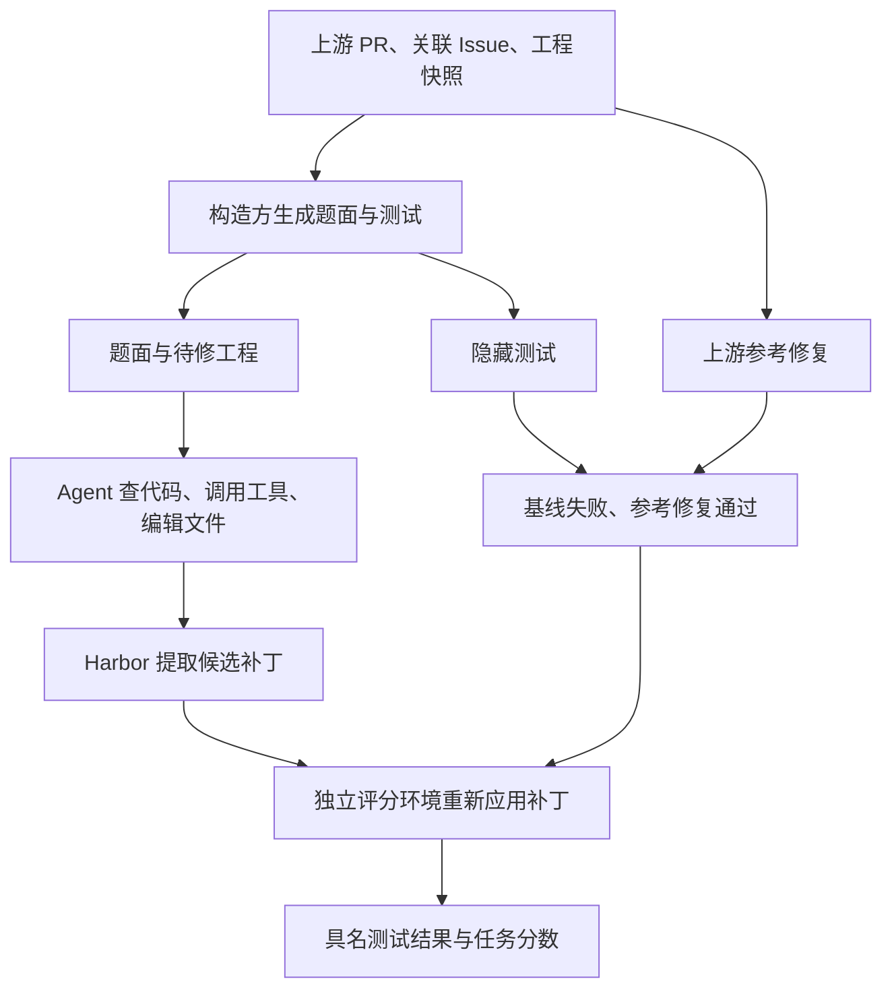

# 基于 HWE-bench v1.1 的学习、研究与诊断

**一项芯片工程故障，怎样从开发者合并的代码改动，变成 Agent 能独立求解、第三方能自动判分的一道题？**

## 一、真实硬件工程里，开发者究竟修了什么？

HWE-bench 从六个开源工程超过 30,000 个合并请求（Pull Request，PR）出发，最终得到 417 道可执行的修复任务。PR 留下了代码从哪个版本改到哪个版本，相关 Issue 有时记录现象，有时只列后续工作。要把这段历史交给一个能读写仓库、运行工具的模型 Agent，需要还原修复前的工程，写出它应该满足的行为，再做出能判断补丁对错的测试。[论文](https://arxiv.org/html/2604.14709v3) · [v1.1 数据集](https://huggingface.co/datasets/henryen/hwe-bench/tree/ef3f000af6abdb4a8b4ba6292069694f4d17f14d)

v1.1 榜单上的七套模型与工具组合，通过率都超过 90%。这个分数的分母究竟包括什么？要解释它，得先沿着一道题往回追：开发者遇到了什么故障，制题者保留了哪些线索，裁判又能观察到哪些行为。

六个工程覆盖处理器核、生成器、片上系统和硬件信任根。下面各取一个入选 PR，从现象对照修复动作。这样才能看清同一个“修 Bug”标签底下，工程师做的是哪些不同的判断。

**Ibex（35 题）｜CPU 进入调试状态后，谁还能拒绝它的内存访问？** Ibex 是一个小型 RISC-V 处理器核。PMP（物理内存保护）通常按地址和权限决定能否取指、读写。在 Debug Mode 下，处理器必须能够访问调试模块所在的地址范围，原检查却可能将合法访问挡住。上游把调试状态和调试地址范围接入 PMP 判断，使范围内的访问获得放行，范围外仍走原有规则。工程师需要先确定例外成立的两个条件，再决定在哪条权限路径上实现它。这也是后文贯穿制题和评分的例子。[PR #2232](https://github.com/lowRISC/ibex/pull/2232)

**Rocket Chip（32 题）｜刚退出复位，指令缓存为什么会报告命中？** 这个片上系统生成器用 Chisel 描述硬件。指令缓存用寄存器 `s2_hit` 保存前一流水级的命中结果。第一次真正的查询还没建立结果时，缺少复位初值就可能让它报出有效响应。参考补丁只改一行，把 `RegEnable(s1_hit, !stall)` 改成 `RegEnable(s1_hit, Bool(false), !stall)`。增加的参数规定了复位后的值；稳态运行时的命中计算可以原样保留。[PR #404](https://github.com/chipsalliance/rocket-chip/pull/404)

**香山（54 题）｜一个队列条目里，部分指令提交、部分被冲刷，这一项算完成了吗？** 香山是高性能乱序 RISC-V 处理器。前端的 FTQ（取指目标队列）按条目记录取指与预测信息，但后端反馈的是指令的提交或冲刷。遇到两种状态混合，按原条件推进指针，可能连带影响预测器更新。补丁重新判断条目中最后一条有效指令是否已经提交，并区分条目提交与指针前移的条件。它和 Rocket #404 都只动一个文件，读懂这个改动却需要跟踪多个周期的状态。[PR #3307](https://github.com/OpenXiangShan/XiangShan/pull/3307)

**Caliptra RTL（16 题）｜最后一个数据拍正常，整次密钥读取就成功了吗？** 在这个硬件信任根子系统中，一次密钥传输要经历多个时钟周期。原逻辑可能让末拍的正常状态覆盖前面出现的错误。上游让错误一旦发生便保留到这次访问结束。同一个 PR 还修正 AES 读取新密钥时对中间暂存寄存器的清零。一个 PR 编号下有两项验收条件；只测错误锁存，无法说明清零也正确。[PR #963](https://github.com/chipsalliance/caliptra-rtl/pull/963)

**OpenTitan（245 题）｜时钟已经停了，复位还能传到下游吗？** 在这个安全片上系统里，故障落在复位管理器的连接关系上。外部上电复位信号有效时，部分时钟可能已经停止，原有复位路径无法可靠覆盖有关内部节点。上游调整复位树，让相关节点从适当的上电复位源获得复位。与 Rocket #404 相比，这里需要验证的是信号能否到达目标模块，检查一个寄存器的复位值还不够。[PR #10732](https://github.com/lowRISC/opentitan/pull/10732)

**CVA6（35 题）｜为什么一项“硬件评测”会要求改 C++？** CVA6 工程包含配套的 Spike 指令集模拟器。模拟器匹配一类扩展指令时，对 `funct7` 字段使用的掩码是 `0xe`，漏查若干编码位，可能把不支持的编码判成匹配。补丁将掩码改为 `0x7e`。修复发生在软件译码逻辑里，正确与否取决于硬件指令编码契约。这道题在数据中归为 `SW_BUG_FIX / SW_FW_LOGIC`。[PR #1482](https://github.com/openhwgroup/cva6/pull/1482)

六个工程的样本权重相差很大。OpenTitan 独占 245/417，约 58.75%。后面读总榜时，这个分母决定了哪些工程的表现对总成绩影响最大。[逐项目统计](https://github.com/5Mcv4He/hwe-bench-study/blob/main/evidence/projects.csv)

<a id="engineering"></a>

## 二、超过 30,000 个 PR，怎样筛成能制题的候选？

上面六例来自最终数据。回到制题起点，开发者合并 PR 时并没有替评测者准备好题目。HWE-bench 的前八步先处理三件事：取得上下文、识别修复、估计能否复现。上游用 s01–s11 标识各阶段，前一阶段输出的 JSONL（每行一条 JSON 记录）供下一阶段读取。[采集流程源码与逐阶段说明](https://github.com/pku-liang/hwe-bench/tree/7bab86a/hwe_bench/collect)

| 源码阶段 | 谁做、具体做什么 | 这一阶段结束时得到了什么 |
|---|---|---|
| s01 收集 PR | 用 GitHub API 分页读取仓库 PR，给已合并的 PR 补取提交记录 | 包含开发描述、合并状态和提交消息的原始记录 |
| s02 关联 Issue | 检查已关闭、已合并，从标题、正文和提交消息提取 Issue 引用。实现默认调用 DeepSeek，也可以切换为正则匹配 | 一份 PR 对应哪些 Issue 编号。引用能找回上下文，不能单独证明因果 |
| s03 获取 Issue | 对编号去重，用 API 取标题、正文和状态 | 单独的 Issue 记录 |
| s04 合并上下文 | 按编号将 Issue 内容并回对应 PR | 后续分类器能一起读到问题描述和开发者的改动说明 |
| s05 拆补丁 | 取代码差异，按文件路径中的测试标记拆为修复补丁 `fix_patch` 和测试补丁 `test_patch`，丢弃修复部分为空的记录 | 已知修法、随 PR 提交的测试改动，以及变更规模 |
| s06 限制规模 | Python 规则按文件数和增删行数过滤，默认上限分别为 50 和 2,000 | 规模适合继续处理的候选，这一步尚未判断技术难度 |
| s07 判断修了什么 | 分类 Agent 读 PR、Issue 和补丁，输出一级类别、二级类别、置信度和理由 | RTL 修复、软件修复、其他。纯测试、文档、重构、功能新增等按规则归入其他 |
| s08 判断是否适合制题 | Agent 分别评估工程价值、软件问题所需硬件知识、复现线索及仿真成本 | 四个分项和优先级，供制题阶段择取候选 |

**s02 的一个具体陷阱。** Ibex #2232 关联的 #2233 是为这次修改另开的验证待办。读它可以知道工程师想覆盖哪些情况，却不能把它写成最初发现故障的记录。采集器检索引用时承担的是找线索的工作。最终数据还有两条关联 Issue 列表为空；公开实现的筛选规则和发布数据的实测属性，应分别描述。[Issue #2233](https://github.com/lowRISC/ibex/issues/2233) · [关联逻辑](https://github.com/pku-liang/hwe-bench/blob/7bab86a/hwe_bench/collect/s2_filter_by_issues.py)

**s07 怎样区分 Bug？** 一级标签回答根因落在 RTL 设计、软件还是其他改动。二级标签才回答具体违反了哪种约束。下面是 v1.1 对 417 条任务的实际计数；分类提示中列出了兜底标签，最终数据恰好没有题使用它们。[分类提示](https://github.com/pku-liang/hwe-bench/blob/7bab86a/hwe_bench/collect/s7_instruction.py) · [计数表](https://github.com/5Mcv4He/hwe-bench-study/blob/main/evidence/task_labels.csv)

| 根因类别 | 二级标签与实际题数 | 分类时看的证据 |
|---|---|---|
| RTL 设计，407 题 | 功能逻辑 136、接口协议 100、规格实现 85、配置集成 46、时序同步 40 | 是状态转移算错、握手顺序有误、违反架构规范、接线参数不对，还是时钟复位关系有问题？ |
| 软件，10 题 | 硬件配置 7、软件自身逻辑 2、软硬件交互 1 | 是写错寄存器配置、软件计算本身出错，还是错误处理了中断、状态或握手？ |

分类规则本身也值得核查。Rocket Chip #485 的上游改动引入 AHB 适配器，而纯功能新增按分类规则应属于其他。它的入选提出了一个具体的审查问题：题面把哪种原有行为界定为缺陷？要判定是否误分类，还需对照基线行为、题面与测试，单看 PR 标题无法定论。[PR #485](https://github.com/chipsalliance/rocket-chip/pull/485)

**s08 的高分代表什么？** 四项各取 0–2 分，优先级等于工程价值 × 4，加跨层深度 × 2，加复现线索 × 6，再减仿真成本 × 3。CVA6 #1482 的四项为 1、1、1、0，所以得到 12 分。这里最重的是复现线索：已有明确触发输入和预期行为，会使制题更可行。对于 RTL 类，提示要求跨层深度一项填零，因此不能拿这个零评价香山前后端推理是否复杂。进入 s09 时还可分别设置最低工程价值、最低复现线索等条件；12 分这个例子说明算法如何排序，不能推出一条统一录取线。[打分规则](https://github.com/pku-liang/hwe-bench/blob/7bab86a/hwe_bench/collect/s8_instruction.py) · [下游筛选参数](https://github.com/pku-liang/hwe-bench/blob/7bab86a/hwe_bench/harness/tbgen/prepare_input.py)

再看两个未入选的 PR。Ibex #2216 是已合并的一行修复，寄存器文件的 A 读端口错用了 B 端口地址。#2166 同样已经合并，涉及 6 个文件、增加 110 行、删除 7 行。两者的编号都没有出现在这 417 条数据里，单凭最终名单无法判定是 Issue 关联、人工筛选、制题成本还是运行验证造成了落选。要研究筛选规则偏爱什么，下一份最有价值的材料是逐阶段的候选 ID 与拒绝原因。用零星未入选例子估算整套漏斗会把推断误写成观测。[Ibex #2216](https://github.com/lowRISC/ibex/pull/2216) · [Ibex #2166](https://github.com/lowRISC/ibex/pull/2166) · [v1.1 数据](https://huggingface.co/datasets/henryen/hwe-bench/tree/ef3f000af6abdb4a8b4ba6292069694f4d17f14d)

## 三、筛完 PR 以后，怎样把已知修复变成一道题？

走完 s08，制题者知道哪份代码有问题，也知道上游怎样修。还缺两样东西：一个能自动判断修复是否生效的测试，一份让另一位工程师或 Agent 能独立开工的题面。s09–s11 依次交付它们。[上游验证与制题流程](https://github.com/pku-liang/hwe-bench/tree/7bab86a/hwe_bench/harness)

1. **s09 写复现测试。** 制题端按项目、仓库和 PR 号，把 s08 评分与 s05 保存的代码差异合并。制题 Agent 可以看参考补丁，使用该工程的工具链，写出 `tb_script.sh`，需要时补写环境准备脚本。候选测试要在修复前的代码上测出失败，应用参考补丁后用同一测试测出通过。s05 拆出的 `test_patch` 记录上游提交过什么；这里生成的 `tb_script` 才承担评测复现工作，所以没有随 PR 提交测试的 #2232 仍有机会成为题。[测试生成](https://github.com/pku-liang/hwe-bench/tree/7bab86a/hwe_bench/harness/tbgen)
2. **s10 在标准环境复验。** 把候选测试交给统一验证程序，在按项目准备的 Docker 容器内重新执行两种代码状态，解析带名称的测试结果。若脚本有问题，制题方可修正脚本后再验证。s09 是把一个能触发故障的实验做出来，s10 要确认它换到正式评分流程还能重复。交付物包括通过复验的脚本和两侧运行记录。[标准复验](https://github.com/pku-liang/hwe-bench/tree/7bab86a/hwe_bench/harness/verify)
3. **s11 根据已验证的行为写题面。** 题面说明触发条件、观察到的错误、预期行为及受影响功能。复核时既要核对描述是否和测试一致，也要检查有没有泄漏上游补丁或隐藏用例。最后将审核后的 `problem_statement` 连同验证字段写回数据集。这解释了为什么题面放在制题末尾生成：到此时，制题者才知道裁判在环境里实际观察到了什么。[题面生成与复核](https://github.com/pku-liang/hwe-bench/tree/7bab86a/hwe_bench/harness/psgen)

<a id="environment"></a>

### 跟踪 Ibex #2232：需求、参考解和测试分别给了什么

上游 PR 要求，在处理器已经进入调试模式时，物理内存保护（PMP）应允许对调试模块地址范围的取指、读取与写入。范围外仍遵循原有权限规则。值得注意的是，数据集关联的 Issue #2233 正是为这次改动另开的**验证待办**。它列出了基本读写取指、范围外保护、以及地址与访问类型等组合覆盖三个层次。PR 指出本次提交不含相应验证。因而，仅仅拿到原始补丁，还缺一套可执行的检验手段。[上游 PR #2232](https://github.com/lowRISC/ibex/pull/2232) · [验证 Issue #2233](https://github.com/lowRISC/ibex/issues/2233)

在数据记录里，这道题的标签是 RTL_SPEC，优先级为 17。面向求解者的题面已经交代了触发状态、地址范围、三种访问类型，也指明 PMP 权限检查路径。Agent 的工作仍包括在实际工程里接通信号、实现正确条件并交付可应用的补丁。因为题面已经提供了定位线索，通过这道题能为“按明确契约完成工程修改”提供证据；对“从模糊外部症状独立定位根因”的支持弱一些。[冻结版任务数据](https://huggingface.co/datasets/henryen/hwe-bench/blob/ef3f000af6abdb4a8b4ba6292069694f4d17f14d/hwe_bench_full.jsonl)

**打开隐藏测试，看裁判在什么时刻判错。** 这道题的具名检查叫 `pmp_debug_dm_access`。制题端生成的 shell 脚本组织仿真材料，其中 `tb_pmp_debug_dm.sv` 搭建测试平台，`prim_stubs.sv` 提供仿真所需的原语替身，`sim_main.cpp` 驱动 Verilator 仿真。被测对象仍是实际 Ibex RTL。只看文件名很难理解它到底测了什么，可以按一次执行的顺序读：

1. **进入调试态。** 测试平台在运行中发出 `debug_req` 请求，让处理器转去执行调试程序。这一步建立了 PMP 调试例外生效的前提。
2. **检查范围内读写。** 调试程序从调试模块范围内读出事先写入的 `0xCAFEBEEF`，再将读到的值写到范围内另一个位置。结束时检查实际写回值，可以区分“程序走到这里了”和“数据确实经过了受测读写路径”。
3. **检查范围外仍会触发异常。** 程序再访问一个范围外、受保护的地址，预期由异常处理路径报告结果。如果候选补丁简单地在调试态放行一切，前半段读写会成功，却会在这里暴露错误。
4. **收集判据。** 测试平台同时检查结束标志 `result == 1` 和写回值 `stored_value == 32'hCAFE_BEEF`。错误结束或超过脚本的周期上限都不能通过。记录里错误基线为 FAIL、参考修复为 PASS；这是上游执行结果，此处按脚本解释其含义。[冻结版任务记录](https://huggingface.co/datasets/henryen/hwe-bench/blob/ef3f000af6abdb4a8b4ba6292069694f4d17f14d/hwe_bench_full.jsonl)

这个测试同时问了两个方向的问题：应当放行的访问是否成功，应当拦截的访问是否仍被拦截。它覆盖了一次具体配置与执行路径；Issue 中希望覆盖的所有地址边界和权限组合，仍需逐一检查。

| 从材料里可以确认 | 证据的边界 |
|---|---|
| 上游提出了完整验证愿望，包括组合覆盖 | Issue 中的计划不能充当实际覆盖率报告 |
| 任务记录保存同名检查在测试侧 FAIL、参考修复侧 PASS | 这是作者保存的运行结果。本项目核对了脚本及记录，本轮未重跑 #2232 的完整核级仿真 |
| 实际脚本检查具体配置、地址、访问与终止条件 | 其他地址边界、权限组合、不同实现接口的兼容性需要另外验证 |

### 谁拿到题面，谁拿到答案，模型最后交付什么？

JSONL 的一行把材料装在一起，执行时再分给不同的角色。工程身份与基线提交确定“在哪份代码上做”；`problem_statement` 告诉 Agent “应出现什么行为”；`fix_patch` 给制题者一份已知修复；`tb_script` 给裁判可执行的判据；`f2p_tests` 记录哪些具名检查在错误版本失败、在参考修复上通过（Fail-to-Pass）。Docker 镜像固定仓库和工具链，某些题还有准备脚本。不同工程的仿真器与验证依赖不同，题号相同也必须核对快照与测试版本。[测试生成](https://github.com/pku-liang/hwe-bench/tree/7bab86a/hwe_bench/harness/tbgen) · [构造验证](https://github.com/pku-liang/hwe-bench/tree/7bab86a/hwe_bench/harness/verify) · [题面生成](https://github.com/pku-liang/hwe-bench/tree/7bab86a/hwe_bench/harness/psgen)

从发布数据到一次试次，适配器会把同一条记录拆成不同用途的文件：

| 文件或位置 | 在哪一步使用 | 对求解、评分有什么作用 |
|---|---|---|
| `instruction.md` | Agent 开工时 | 展示经复核的行为要求。求解者从这里理解要改什么 |
| `task.toml`、`environment/` | Harbor 启动试次时 | 描述任务与环境，使求解者在指定的工程快照和工具链中工作 |
| `solution/solve.sh` | 参考解路径 | 供框架运行已知解时使用。独立求解时应隔离参考解 |
| `tests/test.sh` | Harbor 收尾时 | 在这个适配器里负责从工作树提取候选补丁。名字里虽有 test，这一步产生的占位分数还不是功能判定 |
| `tb_script` 与评分日志 | 独立 evaluator 收到补丁后 | 将候选改动应用到干净工程，运行隐藏测试，从具名结果判断是否通过 |

以 #2232 为例，适配器把题面写入 `instruction.md`。求解 Agent 面对的是修复前的工程与可用工具。它查找 PMP 模块、追踪调试状态和地址判断、编辑代码，可以执行自己的检查。这里描述的是任务允许的求解路径；某个模型在某次试验中实际查了什么，需要看那次的工具记录。交付物是工作树相对基线的差异，独立评分器才有隐藏用例来检验它。



这里最容易读错的是两个 `test` 的含义。Harbor 是调度 Agent 和管理试次的运行框架。它的适配模板在任务结束时相对镜像基线提取 Git 差异；这个模板写入的 `reward.txt` 为占位值。随后桥接程序收集非空补丁，外部 evaluator 在干净评分环境运行真正的隐藏测试，解析具名结果。Agent 在自己的终端看到“编译成功”、Harbor 拿到了补丁、外部评测判定通过，是三个不同事件。只有区分它们，才能解释一份空提交、一条工具错误和一个功能断言各自说明什么。[Harbor 收补丁模板](https://github.com/pku-liang/hwe-bench/blob/7bab86a/hwe_bench/harness/harbor/templates/test.sh.j2) · [桥接程序](https://github.com/pku-liang/hwe-bench/blob/7bab86a/hwe_bench/harness/harbor/verify_bridge.py) · [评分入口](https://github.com/pku-liang/hwe-bench/blob/7bab86a/hwe_bench/harness/evaluator.py)

<a id="revision"></a>

## 四、v1.1 改动了哪些判断条件

逐字段对齐两份完整数据后，417 个任务标识一一对应。209 题所有顶层字段相同；158 题仅改测试，20 题仅改题面，29 题同时改测试和题面，1 题连参考修复一起改。按字段统计即 **188 份测试、50 份题面、1 份参考修复**。测试的文本发生变化，数据里保存的基线和参考验证结果字段却相同。作者在发布说明中报告重新验证了修订后的测试；确认这一声明的逐题执行证据，还需要新脚本对应的运行日志。[互斥计数表](https://github.com/5Mcv4He/hwe-bench-study/blob/main/evidence/revisions.csv) · [作者发布说明](https://pku-liang.github.io/hwe-bench/v1.1.html)

| 修订解决什么问题 | 用什么区分“读到修改”和“验证了效果” |
|---|---|
| OpenTitan #12505：测试提供的断言宏只接受某些调用形式，合理的工程写法可能在预处理就失败 | 固定调用，分别用两版测试宏编译。两参调用均通过，三参、四参旧版失败新版通过。这个局部实验验证了签名兼容性，完整 SPI 功能仍需芯片级环境验证。[编译结果](https://github.com/5Mcv4He/hwe-bench-study/blob/main/evidence/replay.json) |
| Ibex #332：只观察挂起请求的地址，还会漏掉分支后交给处理器的指令流错误 | 新测试增加返回数据与请求地址的对应检查，并检查重定向后的下游交付。这里确定的是脚本覆盖范围的改变。固定候选补丁在两版上的成对判定仍待实跑。[上游说明](https://pku-liang.github.io/hwe-bench/v1.1.html) |
| OpenTitan #21632：评分前恢复受保护的验证文件，可以清除求解者留下的测试改动 | 对真实 UART 核与验证记分板应用参考修复，再执行恢复阶段。新版保留了核的改动，却把记分板恢复为基线。若想评价设计与配套验证的共同交付，需要给后者单设验收。[文件指纹实验](https://github.com/5Mcv4He/hwe-bench-study/blob/main/evidence/owned.json) |

## 五、七组系统的高分测出了什么


图左解释总体成功率的权重，图右解释差距集中在哪里。OpenTitan 占了过半题目，另外五个工程的模型表现容易被总分稀释。例如在 Ibex 上，Claude 与 DeepSeek 相差 5 题，但分母只有 35，换成通过率便相差 14.29 个百分点。[作图数据](https://github.com/5Mcv4He/hwe-bench-study/blob/main/evidence/projects.csv)

| 模型与工具系统 | 通过 / 417 | 通过率 | 官方总成本（美元） |
|---|---:|---:|---:|
| Claude Opus 5.5 · Claude Code | 413 | 99.04% | 5,110.22 |
| GPT-6.1 Sol · Codex CLI | 405 | 97.12% | 197.27 |
| GPT-6 Astra · Codex CLI | 405 | 97.12% | 1,094.72 |
| GPT-6 Sol · Codex CLI | 390 | 93.53% | 304.23 |
| Kimi K3.1 Pro · Kimi Code | 386 | 92.57% | 483.17 |
| DeepSeek V4.1 Flash 1017 · DeepSeek Harness | 386 | 92.57% | 112.53 |
| GLM 5.3 · OpenCode | 377 | 90.41% | 1,465.25 |

前六组公布的推理档位均为各厂商的 max，GLM 一行未列。DeepSeek 和 Claude 同时更换了基础模型和 Harness（提供工具、上下文管理和执行循环的软件）。在 Caliptra 的 16 题上七组全过，此时最终通过率已无法给这些系统排序；而在 OpenTitan，成绩仍有差异。Claude 的四个未解都在 OpenTitan，两系统共同未解的题数只能从分项成绩约束到 **0 至 4**。截至本次检查，官方材料没有这两个最新组合的完整逐题轨迹。报告不能把 27 题净差解释为某个模型不懂协议，也不能把价格差换算成验证能力差。[官方分数原表](https://github.com/pku-liang/hwe-bench/blob/7bab86a/website/scores-v1.1.json) · [公开实验材料](https://github.com/pku-liang/hwe-bench-artifacts/tree/a3682069411b5698f456affb17436da1b821ec76)

### 一个实际反例：Ibex #54 的七份 PASS

#54 修正 RISC-V 压缩指令译码。部分编码是合法的 HINT，即允许硬件忽略其操作效果的提示指令；将其标记为非法会引起不同的架构行为。这道题的官方脚本用五个输入验证相关指令。问题在于，其中的移位例子覆盖了移位量为零，却没有同时覆盖目的寄存器为 x0 的那个交点。[上游 PR](https://github.com/lowRISC/ibex/pull/54) · [RISC-V 压缩指令规范](https://docs.riscv.org/reference/isa/v20260120/unpriv/c-st-ext.html)

**本项目实际执行**：取错误基线、参考修复和七份公开历史候选，对每份设计分别运行 v1.0 与 v1.1 的官方脚本。这道题两版脚本相同。再固定输入高 16 位为零，枚举低 16 位的 65,536 种取值，比较是否为压缩指令、非法标志以及展开后的指令三个输出。错误基线在两版均失败，参考及七份候选均通过。扩大输入后出现以下区别。

| 历史候选 | 与参考输出不同的输入数 | 如何解释 |
|---|---:|---|
| GPT-5.4、DeepSeek V3.2 | 各 0 | 本轮限定输入域和三个观测量上全部一致 |
| GPT-5.6 Sol、Claude Opus 4.6、Claude Sonnet 4.6、Qwen3.6 Plus | 各 32 | 都把一组合法提示编码判为非法，其中 0x0002 同时满足零移位量与目的寄存器 x0 |
| Kimi K2.5 | 1 | 改变了保留编码 0x6101 的既有行为。此项是与项目基线及参考实现的差异，规范对保留编码的要求应单独解释 |

历史 GPT-5.6 Sol 的自建测试把目的寄存器从 1 开始遍历，跳过了 x0。因而这里能指出一个实际遗漏的输入，以及一条解释它为何未在自测中暴露的工具记录。这能诊断这一次提交的自测范围，也给出改题的具体办法。七份候选来自历史实验，不能充当上表最新七套系统在 #54 上的表现。穷举也限于这个小译码模块和所声明的输入域。[七份候选的输入定位](https://github.com/5Mcv4He/hwe-bench-study/blob/main/evidence/inputs.json) · [运行结果及反例](https://github.com/5Mcv4He/hwe-bench-study/blob/main/evidence/replay.json) · [GPT 历史试次](https://github.com/pku-liang/hwe-bench-artifacts/tree/a368206/jobs/ibex/gpt5.6-sol/pr-54)

<a id="limits"></a>

## 六、从分数回到能力与训练数据

| 想评价的能力 | 现有证据能支持到哪里 | 后续怎样增强判别力 |
|---|---|---|
| 理解规格与边界 | #2232 检查范围内和范围外的行为，#54 证明故障可藏在两个条件的交点 | 对明示的条件做交叉覆盖，加入只修对一半的候选，确认测试能拒绝它们 |
| 定位根因、利用反馈 | 题面能提示故障子系统。最终通过的一行分数无法说明 Agent 怎样找到文件或如何使用仿真反馈 | 保存每次运行可见的题面、工具退出码、所跑用例、补丁与终止原因，再按相同配置对照 |
| 修复正确性与回归 | 411 题只登记一个具名 Fail-to-Pass 检查，其内部仍可能包含许多输入。全库登记的 Pass-to-Pass 名单为空 | 区分“修复目标行为”和“保留既有行为”，各自记录输入族、结果和失效信号 |
| 工程交付与验证策略 | #21632 显示合法的验证改动可能在评分前被恢复。二元分数难以衡量候选自建测试的质量 | 独立验收设计；另用正确设计与已知错误设计检验候选测试能否分别接受和拒绝 |

如果把这些题用于后训练，首先要知道哪一种反馈值得模型学习。#54 中，遗漏 x0 的候选和考虑了 x0 的候选得到同样的官方通过信号。沿用这一个信号，训练过程就无法从这道题区分两种行为。加入合法边界输入和应保持原状的邻近编码后，才有可执行的判据。**这提供了任务设计的依据；至于训练之后能否迁移到其他译码器、寄存器属性或有状态协议，需要留出新任务验证。**

## 七、初步结论与下一步实验

读完这条链，我对构建专业 Agent 测试有了一个可以实际执行的判断顺序。先从真实工程记录中写清楚预期行为，再保存可复现的错误基线，以参考修复校准验证器。随后给求解者独立环境，从最终工程状态提取补丁，在干净环境里判分。最后再用另外的正确解、部分修复和反例审查验证器本身。HWE-bench 的价值在于把这些层接到了真实硬件工程上；v1.1 的修订和 #54 的局部验证说明，校准之后仍然有检查覆盖的工作可做。

下一项最有信息量的实验是 **Ibex #332 的八格固定补丁重放**。固定错误基线、上游参考修复、两份已有历史候选，分别送入旧版和新版测试，在首次分歧的时钟周期对齐请求地址、授权、返回与实际交付的指令。这样只改变测试版本，就能检验新检查究竟多识别出了哪一种故障。这个实验尚待执行，当前初稿的独立执行范围是 #54 的功能枚举、#12505 的宏编译和 #21632 的文件恢复。[复现说明与已有结果](#reproduction)

<a id="reproduction"></a>

## 八、数据与复现

| 来源 | 本仓库使用方式 |
|---|---|
| [HWE-bench 论文](https://arxiv.org/abs/2604.14709v3) · [基准源码](https://github.com/pku-liang/hwe-bench/tree/7bab86a1018c202395a957f68e918bee4e68f073) | 选材方法、环境适配、补丁提取与离线评分 |
| [v1.0 任务](https://huggingface.co/datasets/henryen/hwe-bench/tree/v1.0) · [v1.1 任务](https://huggingface.co/datasets/henryen/hwe-bench/tree/ef3f000af6abdb4a8b4ba6292069694f4d17f14d) | 两版按 org、repo、PR 号逐一对齐，比较全部顶层字段 |
| [v1.1 发布说明](https://pku-liang.github.io/hwe-bench/v1.1.html) · [成绩原表](https://github.com/pku-liang/hwe-bench/blob/7bab86a/website/scores-v1.1.json) | 作者给出的修订理由、通过数与费用 |
| [实验材料冻结版本](https://github.com/pku-liang/hwe-bench-artifacts/tree/a3682069411b5698f456affb17436da1b821ec76) | 历史模型的真实候选补丁、工具记录和最终评分材料 |

[输入指纹](https://github.com/5Mcv4He/hwe-bench-study/blob/main/evidence/inputs.json)包含两份 JSONL 的 SHA-256 和所用 Git 文件的 blob 指纹。以下命令在仓库根目录运行。默认把原始材料放到单独的本地目录；原始日志、候选补丁及隐藏脚本由上游提供。研究缓存只供分析与评分使用，未来独立求解时应使用隔离环境。

```bash
python3 analysis/materials.py /tmp/hwe-study-input
python3 analysis/summarize.py /tmp/hwe-study-input
python3 analysis/replay.py /tmp/hwe-study-input
python3 analysis/owned.py /tmp/hwe-study-input
```

统计需要 Python 3.9+。后两条需要 Bash、Git，功能与宏重放另需能从 PATH 调用的 Icarus Verilog 及 vvp（本次为 13.0）。按官方任务脚本约定在临时目录运行 Ibex，用临时工作路径替换固定的 /home/ibex。无需 GPU、模型 API 或整套 Docker 镜像。离线环境可直接读下列结果。

| 文件 | 含义 |
|---|---|
| [projects.csv](https://github.com/5Mcv4He/hwe-bench-study/blob/main/evidence/projects.csv) · [systems.csv](https://github.com/5Mcv4He/hwe-bench-study/blob/main/evidence/systems.csv) | 六个工程、七套系统。总成本包括成功与未解任务的支出 |
| [task_labels.csv](https://github.com/5Mcv4He/hwe-bench-study/blob/main/evidence/task_labels.csv) · [revisions.csv](https://github.com/5Mcv4He/hwe-bench-study/blob/main/evidence/revisions.csv) | 官方构造标签频数；按实际发生变化的字段组合互斥计数 |
| [replay.json](https://github.com/5Mcv4He/hwe-bench-study/blob/main/evidence/replay.json) | Ibex #54 的 18 次官方脚本运行、9 组低半字枚举，以及 OpenTitan #12505 的 6 次宏编译；分歧输入为十六进制 |
| [owned.json](https://github.com/5Mcv4He/hwe-bench-study/blob/main/evidence/owned.json) | UART #21632 的两个上游文件在应用参考修复前、应用后、执行恢复阶段后的 SHA-256 |

图表从 projects.csv 生成。需要 Pillow 和支持中文的字体，可运行 `python3 analysis/figure.py --font /path/to/cjk-font.ttc`。Ibex #2232 正文引用的是数据记录及脚本静态核查。不同案例的证据层级在正文分别标明。
