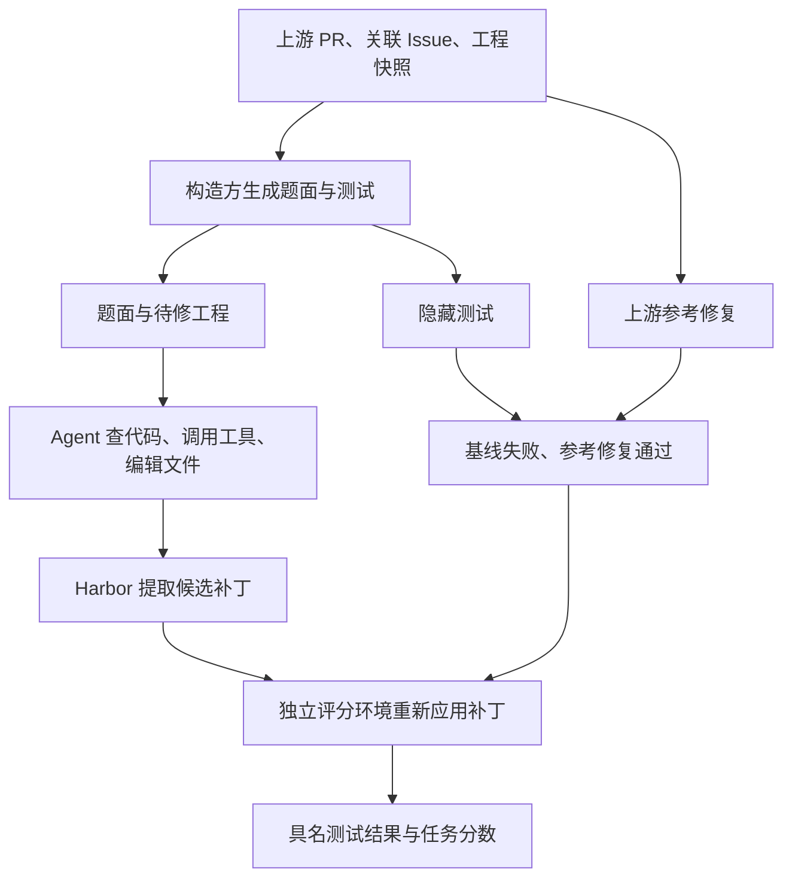
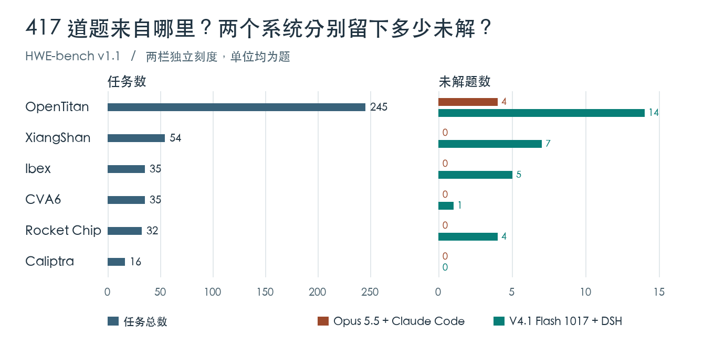

# 基于 HWE-bench v1.1 的学习、研究与诊断

**研究初稿 v0.1 · 2026 年 11 月 23 日**

> 相关研究记录：[研究底稿](research-notes.md)。

## 一、为什么从验证工程的角度读这个榜单

如果一位工程师告诉我“这个 Bug 修好了，仿真也过了”，我会先问：复现了什么现象？哪一个信号表明之前错了？如果换一种看起来也合理的修法，这个测试能把它判错吗？读 HWE-bench v1.1 时，我遇到了同样的问题。七套 Agent 系统在 417 道真实工程修复题上全部超过 90%。这里的 Agent 指能在工程目录里读文件、编辑代码、调用工具并根据反馈继续工作的模型系统。分母很清楚，分子里每一个“修好”的含义值得拆开看。[官方榜单](https://pku-liang.github.io/hwe-bench/)

本文沿着一道题的生命周期展开。先看故障发生在什么硬件里，再看上游工程活动怎样被筛成候选题、怎样构建可执行环境，最后才看模型成绩。**#2232 用来解释一道题如何成立，#54 用来检验一道已经成立的题能证明多少。** 本文把作者记录、读取源码所得的结论和本项目实际运行的结果分别标明。[数据与复现实验](../evidence/README.md)

## 二、从六个工程的开发历史里选出 417 道题

### 先定位工程，才能理解故障

RTL 是寄存器传输级描述，用来规定电路在每个时钟周期如何传送数据和更新状态。这六个仓库处在不同的设计层级。同是“改一段 RTL”，可能是在改一个寄存器的复位值，也可能要协调处理器前端、流水线和整个复位网络。

| 工程与题数 | 工程里有什么 | 一个入选 PR 暴露出的工程问题 |
|---|---|---|
| Ibex · 35 | 小型 RISC-V 处理器核。取指、译码、执行、访存和权限检查共同决定一条指令能否完成 | 调试状态改变了特定地址范围的访问语义，原权限路径仍可能拒绝合法访问。[#2232](https://github.com/lowRISC/ibex/pull/2232) |
| CVA6 · 35 | 可配置 RISC-V 处理器核。工程还包含参考模拟器等软件，用来核对指令行为 | Spike 软件模拟器匹配一类扩展指令时，掩码少检查了若干位。修复落在 C++ 和对应的供应商补丁里。[#1482](https://github.com/openhwgroup/cva6/pull/1482) |
| Caliptra RTL · 16 | 硬件信任根子系统，包含密钥存储、密码运算模块及控制逻辑 | 一次多拍密钥读取中，末拍的正常状态可能覆盖先前的错误。同一 PR 还修改了密钥暂存寄存器的清理。[#963](https://github.com/chipsalliance/caliptra-rtl/pull/963) |
| Rocket Chip · 32 | 可配置的片上系统生成器，组合处理器、缓存与互连。用 Scala 中的 Chisel 描述硬件 | 指令缓存命中寄存器缺少明确复位初值，复位后可能报出有效响应。参考修复只有一行。[#404](https://github.com/chipsalliance/rocket-chip/pull/404) |
| OpenTitan · 245 | 安全片上系统（SoC）。处理器、复位管理、外设、密码模块及大量验证环境共存 | 部分时钟停止时，上电复位仍须传到下游。故障发生在复位树的连接关系上。[#10732](https://github.com/lowRISC/opentitan/pull/10732) |
| 香山 XiangShan · 54 | 高性能乱序 RISC-V 处理器，有预测取指、乱序执行及按序提交等环节 | 取指目标队列的条目内，部分指令已提交，另一些被冲刷。决定条目何时完成、指针何时前移，要同时考虑这两种状态。[#3307](https://github.com/OpenXiangShan/XiangShan/pull/3307) |

Rocket #404 与香山 #3307 的参考修复都只涉及一个文件。前者用一个问题就能说清预期：复位结束、尚未建立命中结果时，有效位应是什么？后者得沿着同一批指令在多个周期里的状态变化推理。**改动多少文件可以度量交付规模，很难单独度量定位难度。** 六个工程的任务数也极不均衡，OpenTitan 占 245/417，即 58.75%。[论文的项目说明](https://arxiv.org/html/2604.14709v3) · [逐项目统计](../evidence/projects.csv)

### 入选的是什么，落选的又是什么

开发者在 Issue 中记录现象或待办，在 PR（合并请求）里提交代码差异。一份 PR 可以顺手修多个问题，也可以在合并设计修改后另开 Issue 补验证。HWE-bench 从 PR 出发，寻找相关 Issue、修复前的工程快照和实际代码改动。论文报告起点超过 30,000 个 PR，最终有 417 个验证任务。中间各步的完整淘汰名单在本次查阅的材料中没有找到。[论文构造方法](https://arxiv.org/html/2604.14709v3) · [收集源码](https://github.com/pku-liang/hwe-bench/tree/7bab86a/hwe_bench/collect)

| 环节 | 实际输入、判断和去向 | 对样本形成的影响 |
|---|---|---|
| 找到开发上下文 | 从仓库取 PR 与提交，检查合并状态，从描述和提交信息提取 Issue 引用，拉取 Issue 正文 | “被引用”可以表示后续验证工作。最终 417 条里还有 2 条关联列表为空，不能给每题都硬配一个原始故障 Issue |
| 拆代码与测试 | 比较修复前后文件，根据路径中的 test、tb 等标记分成 fix_patch 和 test_patch。命令行默认上限为 50 个文件、增删合计 2,000 行 | 规则使小而可控的改动更易进入后续阶段。路径启发式也可能把验证工程文件保留在 fix_patch 里 |
| 判断修复类型 | 分类 Agent 读取 PR、Issue、补丁，输出 RTL 修复、软件修复或其他，再给二级标签 | 标签描述构造端对问题的判断。按 v1.1 全量统计，逻辑 136、接口 100、规格 85、配置集成 46、时序同步 40，另有软件类 10 |
| 估计制题可行性 | 为工程价值、软硬件跨层深度、复现线索、仿真成本评分。优先级分别以 4、2、6、−3 加权；下游筛选条件可配置 | 复现线索对排序很重要。RTL 类被要求把跨层字段置零，零值无法用来证明任务只需单模块推理 |
| 验证与入库 | 生成测试，实际检查错误基线与参考修复，再生成、复核题面 | 最终样本取决于能否在给定环境里稳定制造并检测现象，公开数据允许复核入选结果 |

[Issue 关联](https://github.com/pku-liang/hwe-bench/blob/7bab86a/hwe_bench/collect/s2_filter_by_issues.py) · [补丁筛选](https://github.com/pku-liang/hwe-bench/blob/7bab86a/hwe_bench/collect/s6_filter_by_patch.py) · [可行性打分](https://github.com/pku-liang/hwe-bench/blob/7bab86a/hwe_bench/collect/s8_instruction.py) · [标签计数](../evidence/task_labels.csv)

举两个分母之外的例子。Ibex #2216 是已合并的一行修复，寄存器文件的 A 读端口错用了 B 端口地址。#2166 同样已经合并，涉及 6 个文件、增加 110 行、删除 7 行。两者的编号都没有出现在这 417 条数据里，单凭最终名单无法判定是 Issue 关联、人工筛选、制题成本还是运行验证造成了落选。要研究筛选规则偏爱什么，下一份最有价值的材料是逐阶段的候选 ID 与拒绝原因。用零星未入选例子估算整套漏斗会把推断误写成观测。[Ibex #2216](https://github.com/lowRISC/ibex/pull/2216) · [Ibex #2166](https://github.com/lowRISC/ibex/pull/2166) · [v1.1 数据](https://huggingface.co/datasets/henryen/hwe-bench/tree/ef3f000af6abdb4a8b4ba6292069694f4d17f14d)

## 三、一项修复怎样变成可执行的 Agent 任务

### 跟踪 Ibex #2232：需求、参考解和测试分别给了什么

上游 PR 要求，在处理器已经进入调试模式时，物理内存保护（PMP）应允许对调试模块地址范围的取指、读取与写入。范围外仍遵循原有权限规则。值得注意的是，数据集关联的 Issue #2233 正是为这次改动另开的**验证待办**。它列出了基本读写取指、范围外保护、以及地址与访问类型等组合覆盖三个层次。PR 指出本次提交不含相应验证。因而，仅仅拿到原始补丁，还缺一套可执行的检验手段。[上游 PR #2232](https://github.com/lowRISC/ibex/pull/2232) · [验证 Issue #2233](https://github.com/lowRISC/ibex/issues/2233)

在数据记录里，这道题的标签是 RTL_SPEC，优先级为 17。面向求解者的题面已经交代了触发状态、地址范围、三种访问类型，也指明 PMP 权限检查路径。Agent 的工作仍包括在实际工程里接通信号、实现正确条件并交付可应用的补丁。因为题面已经提供了定位线索，通过这道题能为“按明确契约完成工程修改”提供证据；对“从模糊外部症状独立定位根因”的支持弱一些。[冻结版任务数据](https://huggingface.co/datasets/henryen/hwe-bench/blob/ef3f000af6abdb4a8b4ba6292069694f4d17f14d/hwe_bench_full.jsonl)

实际测试名为 `pmp_debug_dm_access`。Testbench 是为设计提供输入、模拟外部环境并检查结果的程序。这道题在处理器核上运行一小段调试程序。它先用一个已知数据值检验范围内读取和写回，再由范围外访问的异常处理路径报告结果。最终判据同时查看结果标志与写回值；意外完成范围外访问或长时间没有进展都会失败。**只检查范围内读成功，便无法排除把整个调试状态都无条件放开的错误方案。** 这也是为什么两个方向的检查都要保留。

| 从材料里可以确认 | 证据的边界 |
|---|---|
| 上游提出了完整验证愿望，包括组合覆盖 | Issue 中的计划不能充当实际覆盖率报告 |
| 任务记录保存同名检查在测试侧 FAIL、参考修复侧 PASS | 这是作者保存的运行结果。本项目核对了脚本及记录，本轮未重跑 #2232 的完整核级仿真 |
| 实际脚本检查具体配置、地址、访问与终止条件 | 其他地址边界、权限组合、不同实现接口的兼容性需要另外验证 |

### 为什么需要数据集、环境和两次运行

JSONL 的一行把材料装在一起，执行时再分给不同的角色。工程身份与基线提交确定“在哪份代码上做”；`problem_statement` 告诉 Agent “应出现什么行为”；`fix_patch` 给制题者一份已知修复；`tb_script` 给裁判可执行的判据；`f2p_tests` 记录哪些具名检查在错误版本失败、在参考修复上通过（Fail-to-Pass）。Docker 镜像固定仓库和工具链，某些题还有准备脚本。不同工程的仿真器与验证依赖不同，题号相同也必须核对快照与测试版本。[测试生成](https://github.com/pku-liang/hwe-bench/tree/7bab86a/hwe_bench/harness/tbgen) · [构造验证](https://github.com/pku-liang/hwe-bench/tree/7bab86a/hwe_bench/harness/verify) · [题面生成](https://github.com/pku-liang/hwe-bench/tree/7bab86a/hwe_bench/harness/psgen)

这里最容易读错的是两个 `test` 的含义。Harbor 是调度 Agent 和管理试次的运行框架。它的适配模板在任务结束时相对镜像基线提取 Git 差异；这个模板写入的 `reward.txt` 为占位值。随后桥接程序收集非空补丁，外部 evaluator 在干净评分环境运行真正的隐藏测试，解析具名结果。Agent 在自己的终端看到“编译成功”、Harbor 拿到了补丁、外部评测判定通过，是三个不同事件。只有区分它们，才能解释一份空提交、一条工具错误和一个功能断言各自说明什么。[Harbor 收补丁模板](https://github.com/pku-liang/hwe-bench/blob/7bab86a/hwe_bench/harness/harbor/templates/test.sh.j2) · [桥接程序](https://github.com/pku-liang/hwe-bench/blob/7bab86a/hwe_bench/harness/harbor/verify_bridge.py) · [评分入口](https://github.com/pku-liang/hwe-bench/blob/7bab86a/hwe_bench/harness/evaluator.py)

## 四、v1.1 改动了哪些判断条件

逐字段对齐两份完整数据后，417 个任务标识一一对应。209 题所有顶层字段相同；158 题仅改测试，20 题仅改题面，29 题同时改测试和题面，1 题连参考修复一起改。按字段统计即 **188 份测试、50 份题面、1 份参考修复**。测试的文本发生变化，数据里保存的基线和参考验证结果字段却相同。作者在发布说明中报告重新验证了修订后的测试；确认这一声明的逐题执行证据，还需要新脚本对应的运行日志。[互斥计数表](../evidence/revisions.csv) · [作者发布说明](https://pku-liang.github.io/hwe-bench/v1.1.html)

| 修订解决什么问题 | 用什么区分“读到修改”和“验证了效果” |
|---|---|
| OpenTitan #12505：测试提供的断言宏只接受某些调用形式，合理的工程写法可能在预处理就失败 | 固定调用，分别用两版测试宏编译。两参调用均通过，三参、四参旧版失败新版通过。这个局部实验验证了签名兼容性，完整 SPI 功能仍需芯片级环境验证。[编译结果](../evidence/replay.json) |
| Ibex #332：只观察挂起请求的地址，还会漏掉分支后交给处理器的指令流错误 | 新测试增加返回数据与请求地址的对应检查，并检查重定向后的下游交付。这里确定的是脚本覆盖范围的改变。固定候选补丁在两版上的成对判定仍待实跑。[上游说明](https://pku-liang.github.io/hwe-bench/v1.1.html) |
| OpenTitan #21632：评分前恢复受保护的验证文件，可以清除求解者留下的测试改动 | 对真实 UART 核与验证记分板应用参考修复，再执行恢复阶段。新版保留了核的改动，却把记分板恢复为基线。若想评价设计与配套验证的共同交付，需要给后者单设验收。[文件指纹实验](../evidence/owned.json) |

## 五、七组系统的高分测出了什么

图左解释总体成功率的权重，图右解释差距集中在哪里。OpenTitan 占了过半题目，另外五个工程的模型表现容易被总分稀释。例如在 Ibex 上，Claude 与 DeepSeek 相差 5 题，但分母只有 35，换成通过率便相差 14.29 个百分点。[作图数据](../evidence/projects.csv)

| 模型与工具系统 | 通过 / 417 | 通过率 | 官方总成本（美元） |
|---|---:|---:|---:|
| Claude Opus 5.5 · Claude Code | 413 | 99.04% | 5,110.22 |
| GPT-6.1 Sol · Codex CLI | 405 | 97.12% | 197.27 |
| GPT-6 Astra · Codex CLI | 405 | 97.12% | 1,094.72 |
| GPT-6 Sol · Codex CLI | 390 | 93.53% | 304.23 |
| Kimi K3.1 Pro · Kimi Code | 386 | 92.57% | 483.17 |
| DeepSeek V4.1 Flash 1017 · DeepSeek Harness | 386 | 92.57% | 112.53 |
| GLM 5.3 · OpenCode | 377 | 90.41% | 1,465.25 |

前六组公布的推理档位均为各厂商的 max，GLM 一行未列。DeepSeek 和 Claude 同时更换了基础模型和 Harness（提供工具、上下文管理和执行循环的软件）。在 Caliptra 的 16 题上七组全过，此时最终通过率已无法给这些系统排序；而在 OpenTitan，成绩仍有差异。Claude 的四个未解都在 OpenTitan，两系统共同未解的题数只能从分项成绩约束到 **0 至 4**。截至本次检查，官方材料没有这两个最新组合的完整逐题轨迹。报告不能把 27 题净差解释为某个模型不懂协议，也不能把价格差换算成验证能力差。[官方分数原表](https://github.com/pku-liang/hwe-bench/blob/7bab86a/website/scores-v1.1.json) · [公开实验材料](https://github.com/pku-liang/hwe-bench-artifacts/tree/a3682069411b5698f456affb17436da1b821ec76)

### 一个实际反例：Ibex #54 的七份 PASS

#54 修正 RISC-V 压缩指令译码。部分编码是合法的 HINT，即允许硬件忽略其操作效果的提示指令；将其标记为非法会引起不同的架构行为。这道题的官方脚本用五个输入验证相关指令。问题在于，其中的移位例子覆盖了移位量为零，却没有同时覆盖目的寄存器为 x0 的那个交点。[上游 PR](https://github.com/lowRISC/ibex/pull/54) · [RISC-V 压缩指令规范](https://docs.riscv.org/reference/isa/v20260120/unpriv/c-st-ext.html)

**本项目实际执行**：取错误基线、参考修复和七份公开历史候选，对每份设计分别运行 v1.0 与 v1.1 的官方脚本。这道题两版脚本相同。再固定输入高 16 位为零，枚举低 16 位的 65,536 种取值，比较是否为压缩指令、非法标志以及展开后的指令三个输出。错误基线在两版均失败，参考及七份候选均通过。扩大输入后出现以下区别。

| 历史候选 | 与参考输出不同的输入数 | 如何解释 |
|---|---:|---|
| GPT-5.4、DeepSeek V3.2 | 各 0 | 本轮限定输入域和三个观测量上全部一致 |
| GPT-5.6 Sol、Claude Opus 4.6、Claude Sonnet 4.6、Qwen3.6 Plus | 各 32 | 都把一组合法提示编码判为非法，其中 0x0002 同时满足零移位量与目的寄存器 x0 |
| Kimi K2.5 | 1 | 改变了保留编码 0x6101 的既有行为。此项是与项目基线及参考实现的差异，规范对保留编码的要求应单独解释 |

历史 GPT-5.6 Sol 的自建测试把目的寄存器从 1 开始遍历，跳过了 x0。因而这里能指出一个实际遗漏的输入，以及一条解释它为何未在自测中暴露的工具记录。这能诊断这一次提交的自测范围，也给出改题的具体办法。七份候选来自历史实验，不能充当上表最新七套系统在 #54 上的表现。穷举也限于这个小译码模块和所声明的输入域。[七份候选的输入定位](../evidence/inputs.json) · [运行结果及反例](../evidence/replay.json) · [GPT 历史试次](https://github.com/pku-liang/hwe-bench-artifacts/tree/a368206/jobs/ibex/gpt5.6-sol/pr-54)

## 六、从分数回到能力与训练数据

| 想评价的能力 | 现有证据能支持到哪里 | 后续怎样增强判别力 |
|---|---|---|
| 理解规格与边界 | #2232 检查范围内和范围外的行为，#54 证明故障可藏在两个条件的交点 | 对明示的条件做交叉覆盖，加入只修对一半的候选，确认测试能拒绝它们 |
| 定位根因、利用反馈 | 题面能提示故障子系统。最终通过的一行分数无法说明 Agent 怎样找到文件或如何使用仿真反馈 | 保存每次运行可见的题面、工具退出码、所跑用例、补丁与终止原因，再按相同配置对照 |
| 修复正确性与回归 | 411 题只登记一个具名 Fail-to-Pass 检查，其内部仍可能包含许多输入。全库登记的 Pass-to-Pass 名单为空 | 区分“修复目标行为”和“保留既有行为”，各自记录输入族、结果和失效信号 |
| 工程交付与验证策略 | #21632 显示合法的验证改动可能在评分前被恢复。二元分数难以衡量候选自建测试的质量 | 独立验收设计；另用正确设计与已知错误设计检验候选测试能否分别接受和拒绝 |

如果把这些题用于后训练，首先要知道哪一种反馈值得模型学习。#54 中，遗漏 x0 的候选和考虑了 x0 的候选得到同样的官方通过信号。沿用这一个信号，训练过程就无法从这道题区分两种行为。加入合法边界输入和应保持原状的邻近编码后，才有可执行的判据。**这提供了任务设计的依据；至于训练之后能否迁移到其他译码器、寄存器属性或有状态协议，需要留出新任务验证。**

## 七、初步结论与下一步实验

读完这条链，我对构建专业 Agent 测试有了一个可以实际执行的判断顺序。先从真实工程记录中写清楚预期行为，再保存可复现的错误基线，以参考修复校准验证器。随后给求解者独立环境，从最终工程状态提取补丁，在干净环境里判分。最后再用另外的正确解、部分修复和反例审查验证器本身。HWE-bench 的价值在于把这些层接到了真实硬件工程上；v1.1 的修订和 #54 的局部验证说明，校准之后仍然有检查覆盖的工作可做。

下一项最有信息量的实验是 **Ibex #332 的八格固定补丁重放**。固定错误基线、上游参考修复、两份已有历史候选，分别送入旧版和新版测试，在首次分歧的时钟周期对齐请求地址、授权、返回与实际交付的指令。这样只改变测试版本，就能检验新检查究竟多识别出了哪一种故障。这个实验尚待执行，当前初稿的独立执行范围是 #54 的功能枚举、#12505 的宏编译和 #21632 的文件恢复。[复现说明与已有结果](../evidence/README.md)
